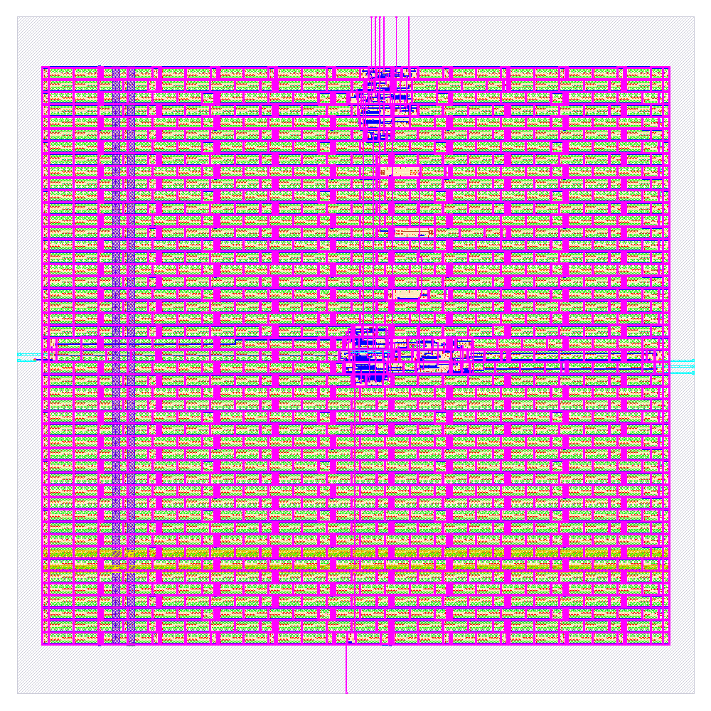

# An open flow for chip development

EE6019 Research Project, MEngSc Electrical and Electronic Engineering, University College Cork, 2026–27.
Supervisor: Prof. Emanuel Popovici.

This repository is a reproducible, fully open-source flow that takes a digital design from Verilog RTL to a sign-off-clean GDSII layout. It is written so that other students can clone it, run one command, and get a chip layout they can inspect and change. The flow is PDK-portable: the same design and scripts run on **SkyWater SKY130** and **IHP SG13G2**.



## Quick start

You need Docker (or Podman), `make`, `python3` and about 20 GB of free disk. See [docs/setup.md](docs/setup.md) for Linux, macOS and Windows (WSL2) instructions.

```bash
git clone https://github.com/mdkamrulislam-web/openFlowForChipDev_EE6019_ResearchProject.git
cd openFlowForChipDev_EE6019_ResearchProject

make sim                     # simulate the example counter (Icarus Verilog)
make sim-verilator           # same testbench, Verilator
make harden                  # RTL to GDS on SKY130 with LibreLane
make summary                 # DRC / LVS / timing sign-off table
make harden summary PDK=ihp-sg13g2   # the same design on IHP SG13G2
```

The first command downloads the tool image once (about 3.9 GB). A full `make harden` of the counter takes two to three minutes on a laptop.

## What the flow does

```
 RTL (Verilog) ──► simulation ──► synthesis ──► floorplan ──► placement ──► CTS ──► routing ──► sign-off ──► GDSII
                 Icarus/Verilator   Yosys        OpenROAD      OpenROAD     OpenROAD  OpenROAD    Magic, KLayout,
                                                                                                 Netgen, OpenSTA
```

Every stage from synthesis to sign-off is driven by **[LibreLane](https://github.com/librelane/librelane)**, the continuation of OpenLane 2 now maintained under the FOSSi Foundation after Efabless closed. Configuration files are the same format as OpenLane 2. Sign-off covers design-rule checks (Magic and KLayout), layout-versus-schematic (Netgen), antenna checks and static timing across process corners. Each stage is explained in [docs/flow.md](docs/flow.md). New to physical design? Start with [docs/learning-path.md](docs/learning-path.md).

## Pinned tool environment

All tools and PDKs come from one container image, pinned by tag and digest in [`env/tools.env`](env/tools.env):

| | Version in the pinned image |
|---|---|
| Image | [IIC-OSIC-TOOLS](https://github.com/iic-jku/IIC-OSIC-TOOLS) `2026.09` (amd64 and arm64) |
| LibreLane | 3.1.0.dev3 |
| Yosys | 0.69 |
| OpenROAD | 26Q3-2443 |
| Magic | 8.3.684 |
| KLayout | 0.30.5 |
| Icarus Verilog | 14.0 (devel) |
| Verilator | 5.052 |
| PDKs | `sky130A`, `ihp-sg13g2`, `gf180mcuD` (installed in the image) |

Nothing is installed on the host apart from Docker. The Makefile runs each command inside the container through [`scripts/run-in-container.sh`](scripts/run-in-container.sh), so results do not depend on the machine. To upgrade the tools, change the tag and digest in `env/tools.env`, rerun the flow, and record the change in the pull request.

## First result: 8-bit counter

The example design is an 8-bit synchronous counter with enable and a wrap flag ([`designs/counter/src/counter.v`](designs/counter/src/counter.v)), checked by a self-checking testbench against a reference model ([`designs/counter/tb/counter_tb.v`](designs/counter/tb/counter_tb.v)). Clock target 50 MHz, die 150 × 150 µm.

| Check | SKY130 (`sky130_fd_sc_hd`) | IHP SG13G2 (`sg13g2_stdcell`) |
|---|---|---|
| Simulation (Icarus, Verilator) | pass | pass |
| DRC (routing, Magic, KLayout) | 0 | 0 |
| LVS errors | 0 | 0 |
| Antenna violations | 0 | 0 |
| Setup / hold violations | 0 / 0 | 0 / 0 |
| Worst setup slack | 9.17 ns | 10.34 ns |
| Worst hold slack | 0.11 ns | 0.13 ns |
| Standard cells (incl. fill, taps) | 298 | 68 |

The IHP layout is in [docs/counter-ihp-sg13g2.png](docs/counter-ihp-sg13g2.png).

## Repository layout

```
designs/<name>/src/      RTL
designs/<name>/tb/       testbench (<name>_tb.v, prints PASS on success)
designs/<name>/config.json   LibreLane configuration
designs/<name>/runs/<pdk>/   flow outputs (not committed); final views in final/
env/tools.env            pinned container image
scripts/                 container wrapper and sign-off summary
docs/                    setup guide, flow walkthrough, learning path, layout renders
logbook/                 weekly Friday logs
.github/workflows/       CI: lint and simulate, then harden on both PDKs
```

To add a design, copy `designs/counter`, rename the module and files, and run `make sim harden DESIGN=<name>`. See [docs/flow.md](docs/flow.md#adding-your-own-design).

## Project plan

The main deliverable is a flow that students can use to design and tape out chips, so documentation and reproducibility are weighted as heavily as the designs themselves.

1. **Tool environment and first chip run.** Pinned container, example design RTL to GDS, CI. *(done, Sep 2026)*
2. **Agree scope with Prof. Popovici.** Primary PDK (IHP SG13G2 has a live free MPW route; SKY130 has the most teaching material), digital only or mixed-signal, tapeout target and dates.
3. **Verification depth.** cocotb testbenches, gate-level simulation of the routed netlist with SDF timing, formal equivalence (Yosys/EQY), coverage.
4. **A realistic example design.** Something larger than a counter (for example a small RISC-V core or a peripheral with a bus interface), with timing closure at a meaningful clock.
5. **Tapeout path.** Padframe or Tiny Tapeout tile integration for the chosen shuttle, and the extra checks the shuttle requires.
6. **Teaching material.** Step-by-step lab handouts built on this repository, tested with students.
7. **Report.** Evaluation of the flow (run time, quality of results versus PDK, reproducibility) and lessons learned.

## Licence

To be decided with the supervisor before the repository is shared more widely.
