# Start here: from your first circuit to a checked chip layout

This is a guided laboratory manual. It is written for someone who has never made a chip, used GitHub Actions or written a Python hardware test. A laptop, a web browser, internet access and a GitHub account are enough for the main practical route. You do not need to buy a board, book a shuttle, install the physical-design tools or enter card details to follow that route.

The learning result is an 8-bit counter that you understand, a repository containing its source and tests, passing automated checks, a downloadable layout and a datasheet. A layout is a computer file describing geometry. It is not a manufactured chip. The last part explains what happens during submission and fabrication, but the practical work stops before any project order, payment or shuttle submission.

The slides were an overview. This manual supplies the explanations, complete files, observable results and recovery steps needed for independent learning. Work through the parts in order the first time. Later, use Word's Navigation Pane or the contents pages to return to a particular step.

## What you will learn and produce

| Part | What you will understand | What you will do |
|---|---|---|
| 1 — Understand the circuit | Bits, pins, stored state, clocks, reset, enable, Verilog and self-checking tests | Predict the counter before trusting a simulator |
| 2 — Build your project | Templates, files, module names, configuration, commits and Actions | Create a public project, add seven files and inspect your own runs |
| 3 — Understand the layout | Synthesis, placement, clock trees, routing, timing, DRC, LVS and gate-level testing | Read genuine reports, download artifacts and inspect the circuit geometry |
| 4 — Reach the free stopping point | What an evidence package contains, what submission does and how silicon is made | Archive your checked revision; understand the later paid process |
| Appendices | Complete source, optional local simulation, terminology and answers | Rebuild, troubleshoot and extend the example |

## Read these conventions once

**Do** tells you an action. **Why** explains what that action achieves. **Check** describes evidence of success. **If it does not work** gives a recovery path. Do not move past a failed check simply because a later page has more interesting pictures.

Names such as `YOUR_USERNAME` mean your own GitHub account name. Do not type the placeholder literally. The account `mdkamrulislam-web` is the author of the reference example; its screenshots show the reference, not your future project. Your own repository URL and commit ID will differ.

A **commit** is a saved version of the files. A **branch** is a named line of saved versions. The example's verified commit is `61ef06bed008e76000f9ae46d65182e476d15dd6`, abbreviated `61ef06b`. Its branch is `worked-example`. Read this branch or the pinned commit: the repository's `main` branch may still contain the initial empty template until its PR is merged.

An **artifact** is a file or ZIP produced by an automated run, such as test results or a layout. A green status is meaningful only when you know which commit it tested. Save the run URL with the files you download.

Screenshots are evidence and navigation aids. The captions tell you what to look for and what the picture proves. Account-only controls use genuine official GitHub or Tiny Tapeout documentation screenshots, credited as such. Their example account names and older page styling may differ. The counter, workflow and waveform figures come from the real verified project. Predicted tables are explicitly explanations, not simulated screenshots.

## Where the free route ends

The main route uses a public GitHub repository and standard GitHub-hosted Actions runners. GitHub documents free runner usage for public repositories; artifact/storage limits and usage policies still apply. Inspect account usage and remove unneeded old artifacts if necessary. This guide does not rely on paid larger runners, private-repository allowances or a Codespace.

Tiny Tapeout uses free software for preparation, but manufacturing and delivery have a separate cost. A `tt_submission` artifact is merely a package of files. Creating it does not book fabrication. Stop with your checks and archive complete. Opening a cost calculator to learn about prices is different from creating an order or submitting a design revision.

Codespaces can be convenient, but it has separate compute and storage quotas; a stopped Codespace still consumes storage. It is optional, not part of this manual's free browser route. Use the Actions route first. If your class supplies a managed lab environment, the optional local appendix explains the simulation commands without changing the main route.

Sources: [GitHub Actions billing](https://docs.github.com/en/billing/concepts/product-billing/github-actions), [Codespaces billing](https://docs.github.com/en/billing/concepts/product-billing/github-codespaces), [Tiny Tapeout FAQ](https://tinytapeout.com/faq/). Facts and screenshots checked on 8 October 2026. Future templates, prices and website controls may change; the pinned example remains the reference for the measured results in this edition.

## Keep these companion files together

The package contains this Word document, a PDF for reading, a seven-file starter ZIP, screenshot/source provenance and the editable Markdown source. The Word and PDF both contain the complete source appendix, so the lesson does not depend on a screenshot being legible enough to copy code from it.

Keep `counter-starter.zip` next to the manual. If you receive only the document, use the complete source appendix, or download the [exact public reference archive](https://github.com/mdkamrulislam-web/tt-sky130-counter/archive/61ef06bed008e76000f9ae46d65182e476d15dd6.zip) and select only the seven files listed in Part 2. Do not replace a newer official template's workflow or configuration files with an older archive just to reproduce a picture.

Before starting, create a local folder called `tiny-tapeout-learning` for the starter files and another called `evidence` for downloads, run links and observations. An evidence note can be a plain text file. It should record what you changed, which commit passed, what the results say and what still needs checking.


# Part 1 — Understand the circuit before you run the tools

This chapter uses a real, working design: an 8-bit counter prepared from the official Tiny Tapeout SKY130 Verilog template. The reviewed version is commit `61ef06bed008e76000f9ae46d65182e476d15dd6` in [tt-sky130-counter](https://github.com/mdkamrulislam-web/tt-sky130-counter/tree/61ef06bed008e76000f9ae46d65182e476d15dd6). You can read its files without owning a chip. Later chapters show how to copy the template, run the checks and produce a layout.

By the end of this chapter, you should be able to predict the output of this counter without running it, explain each important line of the Verilog and Python, and tell the difference between a working simulation and a fabricated chip. If you can only repeat commands, you are not ready to diagnose a failed result. The worked examples below give you the reasoning needed to interpret those results.

## 1. What are we making?

An **ASIC** is an application-specific integrated circuit: a chip whose hardware performs a chosen job. Our job is deliberately small. Store an 8-bit number, add one when counting is enabled, hold the number when counting is disabled and return to zero when reset is applied at a clock edge.

An 8-bit counter is useful for learning because its behaviour is easy to predict, but it still needs real storage, arithmetic, pins, reset, tests and physical implementation. Making a larger design before understanding these parts makes failures much harder to explain.

The counter does not contain a processor running Python. Its Verilog describes hardware. Verilog is a **hardware description language (HDL)**: a language for describing circuit connections and behaviour. The Python test runs outside the design, in a simulator, to drive inputs and check outputs. There is also no decimal display inside the counter: its output is eight binary bits.

### Logic calculates; stored state remembers

**Logic** calculates an answer from input bits. For example, an AND gate produces 1 only when both its inputs are 1. If its inputs are 1 and 0, its output is 0. A simple gate does not remember that its answer was previously 1; its settled answer depends on the current inputs. Logic with no remembered state is called **combinational logic**.

A counter also needs memory. If its present count is 7, it must remember 7 between clock edges before deciding whether the next value should be 8, 7 or 0. A **register** stores a group of bits. A **flip-flop** is a common one-bit clocked storage element used to build registers. The count has eight stored bits; its arithmetic and control logic calculate their next values. A circuit combining stored state with update rules is called **sequential logic**. In this design, count is the stored state and wrap is a combinational answer calculated from that state and enable.

Do not confuse this small register with a computer's large file store or disk. It holds just the bits of the current number. The register and its update logic are part of the hardware being designed.

### Hardware descriptions differ from software instructions

A Python function normally performs the next statement when execution reaches it. Verilog describes circuit blocks that can operate at the same time. In our design, the counter's register responds to clock edges while the wrap logic remains connected to count and enable. The wrap logic does not wait for a program to “reach” its line before it exists.

The statement order inside the clocked `if / else if` chooses priority for that register update. It does not mean the manufactured circuit contains a processor fetching those source lines as instructions. Synthesis creates the gates and storage needed to realise the stated behaviour. You will still see the simulator execute language events while checking it; simulator execution is how a computer models the circuit, rather than an instruction program placed inside the final chip.

Tiny Tapeout lets multiple designs share one manufactured chip. A **tile** is the rectangle allocated to one design. The shared infrastructure selects which design reaches the board's digital pins. You still describe and test your own circuit; Tiny Tapeout supplies the interface and automated implementation flow. The physical design and manufacturing concepts are introduced on the [official Making ASICs page](https://tinytapeout.com/making_asics/), while the [HDL rules](https://tinytapeout.com/hdl/important/) describe the interface obligations.

### What changes as we move through the flow?

| Stage | What exists at this point | What you can check |
|---|---|---|
| Specification | A written account of inputs, outputs and expected behaviour | Can you predict the output for a particular sequence? |
| RTL | Verilog describing stored state and logic | Does it match the specification? |
| RTL simulation | A simulator executing that Verilog, with a testbench | Does it give the expected answers for the tested cases? |
| Synthesis | A netlist: a list of standard-cell instances and their connections | Did the tools map the intended logic, and were warnings understood? |
| Place and route | Cell locations and wires inside the allocated area | Does the implementation meet area, timing and physical rules? |
| GDS/layout output | Geometric chip-layer data | Is the checked manufacturing layout ready for review? |
| Fabrication and assembly | A physical die, package and eventually a board | Does the real chip work when powered and tested? |

**RTL** means register-transfer level. Here it is Verilog describing registers, which store bits, and logic, which calculates their next values. **Synthesis** converts that description into instances of **standard cells**: predesigned circuit building blocks such as logic gates and flip-flops, selected from a library for the chosen process. A **PDK**, or process design kit, supplies the manufacturing process's cell libraries, device information and layout rules. **Place and route** chooses locations and connects the cells. These implementation steps are often called **hardening**. **GDS** is a geometric layout-file format used in the manufacturing handoff. Opening a layout picture does not manufacture anything.

The learning outcome in this guide is a tested design and checked layout, produced through the browser-based workflow explained later. Reading the files and inspecting the existing public results needs no simulator installed on your laptop. Local simulation is an optional route in the appendix. A later paid submission selects a shuttle and fabrication revision. The worked example has passed automated checks, but it has not been booked, submitted, manufactured or measured on silicon. Do not interpret a green GitHub result as a chip order.

### Check your understanding

Which file becomes the circuit: the Python test or the Verilog design? The Verilog is the hardware description used by implementation. The Python test is the checker. Which step produces a physical chip? Fabrication, followed by assembly and fulfilment; simulation and GDS generation produce computer files.

## 2. Start with bits and pins

A **bit** has two logical values, 0 and 1. Real pins use electrical voltage levels to represent them; throughout the digital examples, we reason with the logical values. A logical 1 does not mean “one volt”: the electrical levels depend on the process and board interface. The hardware chapter uses the appropriate board documentation for those levels. Eight bits together can represent 256 different patterns. Interpreted as an **unsigned** number, those patterns represent decimal 0 through 255.

“Unsigned” matters. This counter uses all eight bits to represent non-negative values. It does not interpret the top bit as a negative sign. The pattern `11111111` therefore means 255 in this design.

### Why does `00000101` mean 5?

Each bit position has a different weight. The rightmost bit is bit 0 and has weight 1. Each position to the left doubles the weight.

| Position | Bit 7 | Bit 6 | Bit 5 | Bit 4 | Bit 3 | Bit 2 | Bit 1 | Bit 0 |
|---|---|---|---|---|---|---|---|---|
| Weight | 128 | 64 | 32 | 16 | 8 | 4 | 2 | 1 |
| Pattern for 5 | 0 | 0 | 0 | 0 | 0 | 1 | 0 | 1 |

Only bit 2 and bit 0 are high, so the value is `4 + 1 = 5`. The same number might appear as decimal `5`, binary `00000101` or hexadecimal `0x05`. These are different ways of writing the same value, not three different states in the circuit.

Use the same reasoning for `10000001`: `128 + 1 = 129`. For `11111111`, add all the weights to obtain 255. If the count is 5, the output pins for bits 2 and 0 are high. A board or controller can read that pattern. A seven-segment display needs additional decoding logic to turn the number into segment patterns; this counter does not include that decoder.

### What does `[7:0]` mean?

In Verilog, `wire [7:0] ui_in` declares a group of eight signals numbered 7 down to 0. This group is often called a **bus**. `ui_in[0]` selects one bit. `ui_in[7:1]` selects seven bits. The colon denotes a range; it does not mean division.

The declaration `output reg [WIDTH-1:0] count` uses `WIDTH`, a named configuration value called a **parameter**, to choose the number of bits. This parameter is selected when assembling the design, rather than being a pin a user changes during counting. With `WIDTH = 8`, that range is `[7:0]`. In this example the wrapper explicitly chooses eight bits, matching Tiny Tapeout's eight dedicated output signals. Section 6 explains `wire` and `reg`; for now, concentrate on the bit range.

### Recognising Verilog number notation

| Expression | How to read it | Value in this example |
|---|---|---|
| `1'b1` | One-bit binary value 1 | Logical high |
| `8'b0000_0001` | Eight-bit binary pattern; the underscore is for readability | Decimal 1; only bit 0 is high |
| `7'b0` | Seven-bit binary zero, padded to the stated width | All seven bits are low |
| `{WIDTH{1'b0}}` | Repeat a one-bit zero `WIDTH` times | Eight zero bits when `WIDTH=8` |
| `0xFF` in Python | Hexadecimal FF | Decimal 255, binary `11111111` |

The width before the apostrophe is important. An 8-bit output cannot store 256 as an unsigned value. That limitation explains overflow later in this chapter.

### Mini exercise

1. Which output bits are high when count is decimal 10?
2. What decimal number is binary `00100001`?
3. How many different patterns can four bits represent?

Answers: 10 is binary `00001010`, so bits 3 and 1 are high. `00100001` is `32 + 1 = 33`. Four bits have `2^4 = 16` patterns, from unsigned 0 to 15.

## 3. Write a specification before writing RTL

A specification tells you what the design must do, without assuming that its implementation is already correct. Here is the actual counter specification derived from its [datasheet source](https://github.com/mdkamrulislam-web/tt-sky130-counter/blob/61ef06bed008e76000f9ae46d65182e476d15dd6/docs/info.md) and [RTL](https://github.com/mdkamrulislam-web/tt-sky130-counter/blob/61ef06bed008e76000f9ae46d65182e476d15dd6/src/counter.v).

| Item | Meaning |
|---|---|
| Stored state | An unsigned 8-bit `count` |
| Clock | Update count on the rising edge of `clk` |
| External reset | `rst_n=0` requests reset; count becomes zero at the next rising edge |
| Count enable | `ui_in[0]=1` requests counting; `ui_in[0]=0` requests hold |
| Priority at an edge | Reset first; otherwise count if enabled; otherwise hold |
| Count output | `uo_out[7:0]` carries the binary count |
| Overflow | Enabled count 255 is followed by count 0 |
| Terminal-count indication | `uio_out[0]` is high while count is 255 and enable is high |
| Bidirectional direction | Only `uio[0]` drives an output; `uio[7:1]` remain inputs |
| Input assumption | Enable is stable and synchronous to the clock; real asynchronous switches need suitable synchronisation and debounce |

The reset and flag descriptions are deliberately precise. “Reset clears the counter” is incomplete: **when** does it clear? “Wrap pulses on overflow” is also too vague for this implementation: its flag is high at 255 **before** the overflow edge, while enabled.

### The next-state rule

Let `old_count` be the value just before a rising edge, and `new_count` be the settled value after that edge. Then:

```text
if rst_n is 0:                new_count = 0
otherwise, if ui_in[0] is 1:  new_count = (old_count + 1) modulo 256
otherwise:                   new_count = old_count
```

“Modulo 256” means retain the remainder after dividing by 256. For example, 256 modulo 256 is 0; 257 modulo 256 is 1. You can also think of this as keeping only the lowest eight bits of the sum.

The flag follows a separate rule, evaluated from the current count and enable:

```text
wrap = 1 when current_count is 255 and ui_in[0] is 1
wrap = 0 otherwise
```

There is no stored `wrap` register in this design. If enable changes, wrap can change without waiting for a clock edge. Count itself still waits for a rising edge.

### What you should be able to check now

Before opening an editor, explain these three cases aloud:

- Count is 7; reset is inactive and enable is 0. The next count is 7.
- Count is 7; reset is inactive and enable is 1. The next count is 8.
- Count is 7; reset is active and enable is 1. The next count is 0 because reset wins.

If your written tests disagree with any of those answers, fix the expected behaviour before debugging the tools.

## 4. Clock, state, reset and enable: a worked trace

### What is a clock edge?

A clock alternates between logical low and high. A **rising edge** is its transition from 0 to 1. A **falling edge** is its transition from 1 to 0. This counter changes its stored state only at rising edges. It does not keep adding while the clock remains high.

Think of the register as taking one decision at each rising edge: reset, increment or hold. Between edges, it remembers the last decision's result. This is why the counter is called **synchronous**: the update is coordinated by the clock.

The actual simulation uses a 20 ns clock period. One nanosecond is one billionth of a second. Frequency is `1 / period`, so `1 / 20 ns = 50 MHz`. The period is one complete low/high cycle, not the time from a rising edge to the following falling edge. With the default half-period clock in this test, adjacent opposite edges are 10 ns apart.

### Follow six rising edges

Begin by holding reset active through a rising edge. Do not assume an unreset register already contains zero. A simulator can show an uninitialised value as `X`, meaning its logical value is unknown to the model. This is not a third usable digit between zero and one. Reset establishes a defined starting count that the checker can compare with zero.

| Rising edge | `rst_n` stable before edge | Enable stable before edge | Count after edge | Why |
|---|---|---|---|---|
| A | 0 | 0 | 0 | Reset is active |
| B | 1 | 1 | 1 | Reset released; increment |
| C | 1 | 1 | 2 | Increment again |
| D | 1 | 0 | 2 | Disabled, so hold |
| E | 0 | 1 | 0 | Reset wins even though enable is high |
| F | 1 | 1 | 1 | Reset released; increment from zero |

Changing enable to 0 between C and D does not retroactively undo C. It affects the next edge. Similarly, asserting `rst_n=0` between edges does not instantly reset this particular count register; the next rising edge performs the reset.

### Active-low reset is a naming convention

The suffix `_n` tells the reader that the signal is active low. In the wrapper, `rst_n=0` requests reset. Inside the reusable counter, the signal is named `rst` and is active high. The wrapper converts one convention to the other using `~rst_n`:

| External `rst_n` | Internal `rst = ~rst_n` | Meaning |
|---|---|---|
| 0 | 1 | Reset requested |
| 1 | 0 | Normal operation permitted |

Inverting the signal changes its polarity, not its timing. It does not make the reset asynchronous. The core's `always @(posedge clk)` still determines when count changes.

### Why hold is different from stopping the clock

Enable selects whether count updates at an edge. With enable low, the clock can keep running and count holds. You do not need to create a new clock by ANDing the existing clock with a switch. For this exercise, keep a clean clock and use the enable input.

When testing on a board, use a slow controller-supplied clock or a suitable single-step facility if you want to watch the number. A 50 MHz count changes too quickly to follow by eye. A raw mechanical button bounces and is not a clean clock source.

### Why physical switches need more care than simulator values

The testbench sets enable at a chosen time before the edge. A person can move a switch at any time, including near an edge. An asynchronous input needs an appropriate synchroniser before a clocked circuit uses it. A **synchroniser** is a small input-handling circuit, commonly using successive flip-flops, that reduces the chance that an input transition near a clock edge leaves an unstable value reaching the following logic. It reduces that risk rather than guaranteeing that every transition is captured instantly. A mechanical switch can also change several times during one press; debounce prevents those changes being interpreted as multiple intentional actions. Synchronisation and debounce solve different problems. The minimal counter assumes synchronous enable and does not implement either function.

## 5. Overflow and wrap: predict both signals

### Why does 255 become 0?

The count has only eight storage bits:

```text
  11111111    = 255
+        1
-----------
 100000000    = 256 as a nine-bit result
  00000000    = 0 after retaining only eight bits
```

The carry beyond bit 7 is not part of `count`. This is expected unsigned overflow, not a simulator error. Continuous enabled counting therefore produces `... 253, 254, 255, 0, 1, 2 ...`.

### Watch the flag at the same time

Assume reset is inactive and enable stays high:

| Count just before edge | Count after edge | Wrap after edge, once outputs settle |
|---|---|---|
| 253 | 254 | 0 |
| 254 | 255 | 1 |
| 255 | 0 | 0 |
| 0 | 1 | 0 |

The flag is high during the interval when count is 255. At the overflow edge, count becomes zero and the flag returns low. It is a **terminal-count flag**, not a registered “overflow happened” pulse that remains high after the transition to zero.

The name `wrap` is convenient, but the expression in the source is the authoritative behaviour. If a future design needs a pulse after overflow, that is a different specification and requires different RTL and tests.

### What happens if you disable at 255?

With count at 255, lowering enable immediately makes wrap low after combinational settling. At later rising edges the count remains 255 because enable is low. Raising enable makes wrap high again while count is still 255. The next rising edge changes count to zero, after which wrap is low.

| Situation | Count | Enable | Wrap |
|---|---|---|---|
| Running at terminal count | 255 | 1 | 1 |
| Disabled before the next edge | 255 | 0 | 0 |
| Still disabled after several edges | 255 | 0 | 0 |
| Re-enabled, before overflow edge | 255 | 1 | 1 |
| After the next rising edge | 0 | 1 | 0 |

This also explains a subtle reset case. `wrap` is calculated from enable and count; its expression does not directly include reset. If count is 255 and enable is 1, asserting reset can leave wrap high until the next rising edge clears count. Do not promise that reset masks the flag asynchronously.

### Check your understanding

If you see count 0 and wrap 1 in a settled output sample of this exact design, is that expected? No. The combinational condition requires count 255. Before declaring a hardware bug, check that you sampled after outputs settled, that you are looking at the right signal and that the loaded file matches the reviewed revision.

## 6. Read the reusable counter RTL line by line

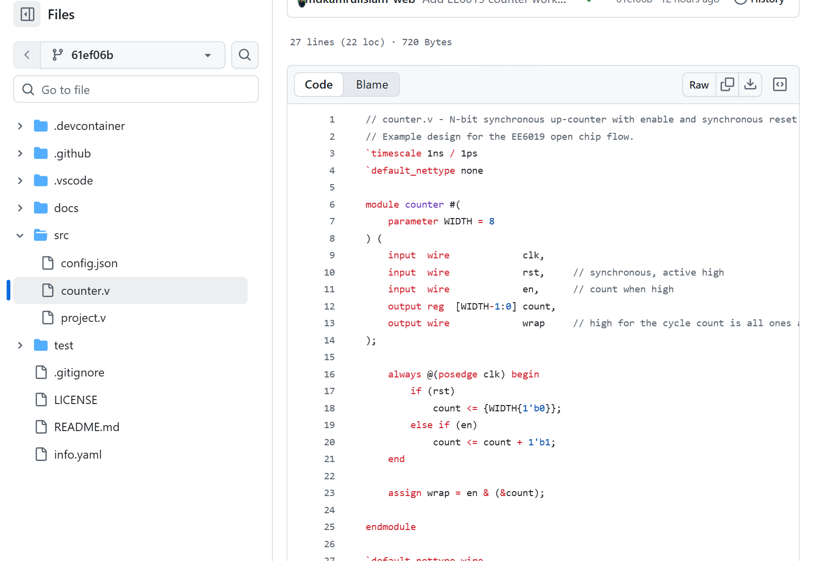


Open [src/counter.v at the reviewed commit](https://github.com/mdkamrulislam-web/tt-sky130-counter/blob/61ef06bed008e76000f9ae46d65182e476d15dd6/src/counter.v). The snippets below preserve its functional statements; some comments are omitted to focus on the code. They are parts of one module, not independent files to compile separately.

### 6.1 File directives and module declaration

```verilog
`timescale 1ns / 1ps
`default_nettype none

module counter #(
    parameter WIDTH = 8
) (
```

`timescale` sets simulation time units and precision for this Verilog file. It does not create a clock and does not select the manufactured chip's operating frequency. The Python test creates the clock later. Mixing files with different or absent timescales can produce lint warnings; the verified layout run reported `TIMESCALEMOD` warnings rather than zero warnings.

`default_nettype none` asks the language tools not to silently invent an implicit wire when a signal name is misspelled. This helps turn a typing error into a useful diagnostic. The file restores the default at its end, after `endmodule`.

`module counter` begins a named hardware block. The `#(...)` part declares a configurable parameter. `WIDTH` defaults to 8. The wrapper will also explicitly set it to 8, so there is no ambiguity about the teaching example's width.

### 6.2 Inputs and outputs

```verilog
    input  wire             clk,
    input  wire             rst,
    input  wire             en,
    output reg  [WIDTH-1:0] count,
    output wire             wrap
);
```

`input` means the block receives that signal; `output` means it supplies that signal to other blocks. `clk`, `rst` and `en` are each one bit. `count` is a `WIDTH`-bit vector. `wrap` is one bit.

`wire` and `reg` are Verilog declaration types, rather than a complete physical blueprint. A `wire` represents a logical connection driven by another block or a continuous assignment. The router later creates physical connections for the implemented circuit; the source declaration alone does not specify a metal-layer route.

The `reg` declaration allows `count` to be assigned inside a **procedural block**, a group of statements such as an `always` block that is evaluated for its specified event. The actual edge-sensitive block below makes count stored state. The keyword `reg` alone does not prove that every declaration in arbitrary Verilog becomes a flip-flop; the way it is assigned matters. Here, the clocked assignment is what describes a register. You do not choose storage merely by replacing every `wire` keyword with `reg`.

`wrap` is a `wire` driven by a continuous expression. It does not have to remember its previous value. That is why it can respond to enable changes between clock edges.

### 6.3 The update rule

```verilog
    always @(posedge clk) begin
        if (rst)
            count <= {WIDTH{1'b0}};
        else if (en)
            count <= count + 1'b1;
    end
```

Read this as hardware behaviour:

1. `always @(posedge clk)` reacts to each rising clock edge. It does not mean “run continuously while clk is high.”
2. `if (rst)` checks whether the internal active-high reset is asserted at that edge.
3. `{WIDTH{1'b0}}` constructs a vector of zeros, matching the count width.
4. `count <= ...` is a nonblocking assignment. In this clocked context, it schedules the register's next value. The `<=` here is assignment syntax, not a comparison asking whether count is less than something.
5. `else if (en)` is reached only when reset is not asserted. That ordering gives reset priority.
6. `count + 1'b1` calculates the next count. Storing it in an 8-bit register retains eight bits, so 255 increments to zero.
7. There is no final `else` assignment. In this clocked block, no assignment means the register keeps its previous value. That implements hold when neither reset nor enable requests an update.

Do not generalise the last point to all Verilog. Omitting assignments in a combinational block can create unintended storage called a latch, rather than the continuously calculated result you meant to describe. The hold behaviour here follows specifically from the rising-edge register block. This example needs count storage; it does not need accidental additional storage in its output calculations.

### 6.4 The terminal-count flag

```verilog
    assign wrap = en & (&count);
```

`assign` continuously drives an expression. The inner `&count` is a **reduction AND**: combine all count bits into one answer. It is 1 only when every count bit is 1. For eight bits, that means count 255.

The outer `en & ...` combines that answer with the one-bit enable. The result is 1 only when both are 1. Parentheses make the two uses of `&` easier to distinguish. This is why disabling at 255 suppresses wrap and why wrap is not a stored pulse.

### Check before moving on

Cover the code and reconstruct its three count decisions: reset, increment, hold. Then explain why reset is synchronous, why the largest count is 255 and why wrap can change between edges. If any explanation depends only on a comment rather than the code, locate the actual statement that implements it.

## 7. Connect the counter to Tiny Tapeout's fixed interface

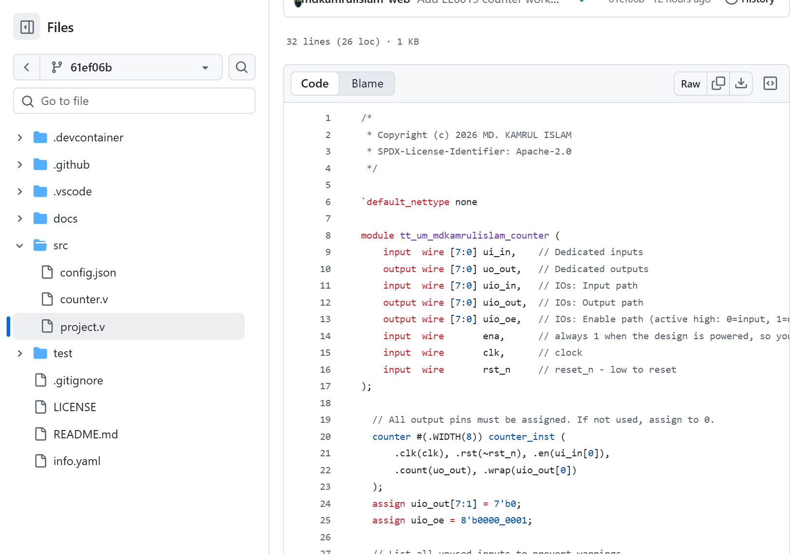


The reusable counter does not know Tiny Tapeout's pin names. A **wrapper** connects its simple signals to the platform's fixed interface. Open [src/project.v](https://github.com/mdkamrulislam-web/tt-sky130-counter/blob/61ef06bed008e76000f9ae46d65182e476d15dd6/src/project.v).

### A module, an instance and a file are different things

A **module** defines a named hardware block and its connections. A **file** is a place on disk containing source text; its filename need not equal its module name. An **instance** is a use of a defined module inside a larger design. Think of the module as the block's definition and the instance as that block included in this particular circuit.

| Source file | Module defined there | How this guide uses it |
|---|---|---|
| `src/counter.v` | `counter` | Reusable storage/arithmetic/control block |
| `src/project.v` | `tt_um_mdkamrulislam_counter` | Top wrapper; includes an instance of counter named counter_inst |
| `test/tb.v` | `tb` | Simulator-only top; includes an instance of the wrapper named user_project |

The hardware hierarchy is wrapper → counter. The simulation hierarchy adds tb above the wrapper. A source-file list tells the tools where to find the definitions; a top-module setting tells them which definition is the starting point. These settings answer different questions, so a correct filename does not repair a wrong top-module name.

The top module is `tt_um_mdkamrulislam_counter`. Tiny Tapeout expects a unique top name beginning with `tt_um_`. Its name must agree with `info.yaml` and the instance in `test/tb.v`. The reusable block remains named `counter`; these are two different module names with two different roles.

### 7.1 Understand the interface before using it

| Port | Direction at the wrapper | Width | What this example does with it |
|---|---|---|---|
| `ui_in` | Input | 8 | Uses bit 0 for count enable; ignores bits 7:1 |
| `uo_out` | Output | 8 | Drives the binary count |
| `uio_in` | Input path | 8 | Unused in this example |
| `uio_out` | Output-data path | 8 | Bit 0 carries wrap; bits 7:1 are tied low |
| `uio_oe` | Output-enable path | 8 | Bit 0 is 1; bits 7:1 are 0 |
| `ena` | Input | 1 | Platform selection indication; not used as count enable |
| `clk` | Input | 1 | Clock passed to the counter |
| `rst_n` | Input | 1 | Active-low reset converted to the core's active-high `rst` |

`uio_in`, `uio_out` and `uio_oe` describe three internal paths for the same eight bidirectional user pins. They are not 24 additional physical pins. For each bidirectional pin, an output-enable bit of 1 drives the output data onto the pin; an output-enable bit of 0 leaves the design's output driver disabled so it can be used as an input. The template's fixed interface has eight dedicated inputs, eight dedicated outputs and eight bidirectional user pins, plus its control connections.

### 7.2 The actual instance and connections

```verilog
  counter #(.WIDTH(8)) counter_inst (
      .clk(clk), .rst(~rst_n), .en(ui_in[0]),
      .count(uo_out), .wrap(uio_out[0])
  );
```

`counter` selects the reusable module. `#(.WIDTH(8))` configures its parameter. `counter_inst` names this instance of the module; it is not a new kind of gate and is not the top-module name.

The named-port syntax `.port(signal)` connects a port inside the instance to a signal outside it:

- `.clk(clk)` connects the shared clock to the core's clock.
- `.rst(~rst_n)` converts active-low external reset into active-high core reset.
- `.en(ui_in[0])` uses only the least-significant input bit as the count enable.
- `.count(uo_out)` connects all eight count bits to the eight dedicated output bits.
- `.wrap(uio_out[0])` routes the one-bit flag to bidirectional output bit 0.

### 7.3 Drive the remaining output paths

```verilog
  assign uio_out[7:1] = 7'b0;
  assign uio_oe = 8'b0000_0001;
```

The first line supplies known zero data for the unused output-data bits. The second enables only the driver for `uio[0]`. Bits 7:1 therefore remain input pins even though their unused output-data paths are tied to zero. “Output data is zero” and “the physical pin is driven low” are not equivalent when output enable is zero.

The wrapper also declares:

```verilog
  wire _unused = &{ena, ui_in[7:1], uio_in, 1'b0};
```

The braces concatenate the listed bits. Reducing that group with AND gives zero because it includes a constant zero. This template idiom acknowledges inputs intentionally unused by this design. It does not use `ena` to pause the counter, change the pin direction or create another output pin.

### Pin examples that catch common mistakes

| Value written to `ui_in` | Bit 0 | Count enable? | Explanation |
|---|---|---|---|
| `00000000` | 0 | No | Hold at subsequent edges |
| `00000001` | 1 | Yes | Increment at subsequent edges unless reset is active |
| `10000000` | 0 | No | Setting bit 7 does not set bit 0 |
| `10000001` | 1 | Yes | Bit 7 is ignored; bit 0 still enables |

Writing the number 1 to the bus enables this example. Writing 128 does not. The platform signal `ena` and the counter input `en` have similar names, but they are not interchangeable. The test sets `ena=1` to represent the selected design, then controls counting through `ui_in[0]`.

### Check the three places that must agree

The wrapper defines `module tt_um_mdkamrulislam_counter`. `info.yaml` specifies `top_module: "tt_um_mdkamrulislam_counter"`. `test/tb.v` instantiates `tt_um_mdkamrulislam_counter user_project (...)`. A name change needs corresponding edits in all three places. Both `project.v` and `counter.v` must also appear in `info.yaml` source files and `test/Makefile`'s `PROJECT_SOURCES`, otherwise one route may compile a different set of files from another.

## 8. Understand the simulator and testbench

A **testbench** is the environment that drives a simulated design and checks its answers. It is not part of the fabricated counter. Here it has two cooperating parts:

- `test/tb.v` instantiates the wrapper and exposes signals to the simulator.
- `test/test.py` uses cocotb to drive those signals, track expected behaviour and make assertions.

The simulator is Icarus Verilog in the normal template configuration. It understands the HDL and advances simulated time. **cocotb** connects Python test code to that simulator. The [official cocotb documentation](https://docs.cocotb.org/en/stable/writing_testbenches.html) describes signal values and test execution; the [timing model](https://docs.cocotb.org/en/stable/timing_model.html) explains why observing a clock edge and observing settled downstream outputs are different events.

### 8.1 What `tb.v` does

The actual [testbench source](https://github.com/mdkamrulislam-web/tt-sky130-counter/blob/61ef06bed008e76000f9ae46d65182e476d15dd6/test/tb.v) declares input variables such as `clk`, `rst_n` and `ui_in`, plus output wires such as `uo_out`. It instantiates the project and connects corresponding names. The instance is named `user_project`.

The make configuration uses `TOPLEVEL = tb`. **DUT** usually means “device under test”; in this setup the Python argument named `dut` is a handle to the simulator's top-level tb and its exposed signals. Its top-level `uo_out` wire is connected to the project's output, so Python can check `dut.uo_out.value`. The tests deliberately avoid internal names such as `counter_inst.count`, which may disappear or change after synthesis.

The file also requests waveform recording:

```verilog
  initial begin
    $dumpfile("tb.fst");
    $dumpvars(0, tb);
    #1;
  end
```

`initial` describes a simulation block that starts once. `$dumpfile` names the waveform output and `$dumpvars` selects signals to record. The `#1` is a simulation delay in this block, not a manufactured hardware delay element and not the source of the design clock. The make setup enables FST output; the generated wave file is `tb.fst`.

Inside conditional `GL_TEST` code, the testbench supplies `VPWR` and `VGND` when instantiating the generated gate-level netlist. Those are model power connections used by that simulation configuration. Do not add new power ports to the normal fixed user RTL interface just because you see them in the gate-level testbench branch.

### 8.2 What a passing test proves

A passing test proves that this simulated representation produced the expected values for the cases the test actually exercised. It is valuable evidence, but it does not automatically cover every possible input history. It also does not prove physical wire spacing, setup/hold timing or fabricated silicon operation. Later flow checks answer different questions.

Conversely, a failed assertion can come from incorrect RTL, incorrect expected behaviour, wrong reset polarity, wrong pin selection or incorrect sampling. Start by understanding the first relevant message, not by deleting the assertion.

The reviewed public example passed its RTL and gate-level tests. This guide does not invent a failed counter assertion. The genuine initial metadata validation failure is described in the workflow chapter as a separate setup problem.

## 9. Read the actual cocotb test line by line

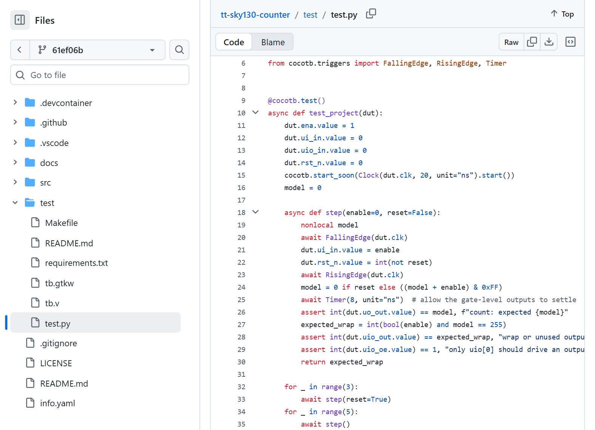


Open [test/test.py at the reviewed commit](https://github.com/mdkamrulislam-web/tt-sky130-counter/blob/61ef06bed008e76000f9ae46d65182e476d15dd6/test/test.py). Each excerpt below comes from that file. Read the excerpts in order; a helper call is not a complete standalone test without the surrounding function, imports and simulator setup.

### 9.1 Imports, test declaration and initial conditions

```python
import cocotb
from cocotb.clock import Clock
from cocotb.triggers import FallingEdge, RisingEdge, Timer

@cocotb.test()
async def test_project(dut):
```

The imports provide the clock generator and timing events used later. The decorator registers the function as a cocotb test. `async def` creates a function that can pause while simulated time or an event advances. An `await` asks it to wait rather than assume the event has already happened. `dut` is the simulator handle described above.

```python
    dut.ena.value = 1
    dut.ui_in.value = 0
    dut.uio_in.value = 0
    dut.rst_n.value = 0
    cocotb.start_soon(Clock(dut.clk, 20, unit="ns").start())
    model = 0
```

These assignments give the simulation known starting inputs. `rst_n=0` requests reset, but the register still needs clock edges to perform that reset. The clock generator runs concurrently with the test. Its period is 20 ns, corresponding to 50 MHz.

The `.value` attribute reads or writes a signal value; `dut.ui_in` alone is a handle to the signal rather than its numeric contents. `model` is a Python number tracking the expected count. Assigning `model=0` does not reach into the design and clear its register. The helper next applies actual reset edges and checks the result.

### 9.2 A helper performs one controlled clock step

```python
    async def step(enable=0, reset=False):
        nonlocal model
        await FallingEdge(dut.clk)
        dut.ui_in.value = enable
        dut.rst_n.value = int(not reset)
        await RisingEdge(dut.clk)
```

`step()` packages repeated test actions into one helper. With no arguments, it disables counting and releases reset. `step(enable=1)` counts. `step(reset=True)` resets with enable defaulting to zero. The test uses only enable values 0 and 1; the helper is not a general specification for arbitrary values written to all eight input bits.

`nonlocal model` allows the nested helper to update the expected-state variable belonging to `test_project`.

The falling-edge wait gives the test a controlled time to drive inputs before the following rising edge. In this 20 ns clock, there is a 10 ns half-cycle between those edges. This avoids deliberately changing inputs at exactly the edge where the register decides its next value.

`int(not reset)` converts the readable Python reset request into the active-low pin value. If `reset=True`, `not reset` is false, so the assigned integer is 0. If `reset=False`, the pin receives 1.

The rising-edge wait moves to the event that updates count. It does not, by itself, guarantee that all downstream outputs have already settled. The next lines handle the expected state and delayed observation.

### 9.3 Calculate the expected answer independently

```python
        model = 0 if reset else ((model + enable) & 0xFF)
        await Timer(8, unit="ns")
        assert int(dut.uo_out.value) == model, f"count: expected {model}"
```

The model uses the written specification: reset wins; otherwise add enable, which is either zero or one in this test. AND with `0xFF` keeps the lowest eight bits. If the previous model is 255 and enable is 1, the intermediate Python sum is 256; masking it gives zero. Python's integer itself can hold 256, so the mask deliberately models the hardware width.

The model is not copied from the observed output. It predicts an answer from inputs and previous expected state, then the assertion compares hardware with that prediction. If you set `model = int(dut.uo_out.value)` here, you would make a much weaker checker that accepts whatever the design did.

The timer waits 8 ns after the rising edge before sampling, giving the functional gate-level outputs time to settle in this test configuration. It does not prove every real path takes less than 8 ns, and it is not a replacement for static timing analysis. If you later change the clock period or the simulation models, re-evaluate the timing assumptions rather than copying the delay blindly.

The assertion says “observed count must equal expected model.” Its error message includes the expected number. A Python assertion is an actual pass/fail condition; merely logging a reassuring message would not check the design.

### 9.4 Check wrap and pin direction as well

```python
        expected_wrap = int(bool(enable) and model == 255)
        assert int(dut.uio_out.value) == expected_wrap, "wrap or unused output"
        assert int(dut.uio_oe.value) == 1, "only uio[0] should drive an output"
        return expected_wrap
```

Here `model` is the expected count after the edge. Therefore, when that count is 255 and enable is 1, the expected flag is 1. On the next enabled edge the model becomes zero and the expected flag becomes zero.

The test compares the whole eight-bit `uio_out` bus with integer 0 or 1. That checks more than bit 0: it also requires unused output-data bits 7:1 to be zero. Comparing the complete `uio_oe` bus with 1 checks the direction pattern `00000001`, not merely that one chosen bit is high.

The helper returns the expected flag after asserting that the observed output matches it. The later loop adds these return values to count terminal-count indications. This sum is safe as a check because a mismatching observed flag would already fail an assertion inside the helper.

### 9.5 Understand every tested phase

The test is one cocotb test function containing many edge-level checks. “1 test passed” does not mean that it checked only one count value.

| Test phase in the actual file | What it does | Expected state/evidence |
|---|---|---|
| Three `step(reset=True)` calls | Apply reset at several rising edges | Count 0; wrap 0; direction pattern 1 |
| Five `step()` calls | Release reset but leave enable low | Count still 0 |
| 266 enabled steps | Traverse one full 256-count cycle and ten more increments | Final count 10; one sampled terminal indication |
| Assert `wraps == 1` | Check the number of terminal indications in that traversal | Exactly one, at count 255 |
| Twenty disabled steps | Check hold over multiple edges | Count remains 10 |
| Seven enabled steps | Resume from the held state | Count advances to 17 |
| `step(enable=1, reset=True)` | Request reset while enabled | Count becomes 0; reset priority |
| One default step, then five enabled steps | Hold zero, then restart | Count progresses to 5 |
| Reset and 255 enabled steps | Arrive at terminal count | Count 255; wrap 1 |
| Three default steps | Disable while at terminal count | Count stays 255; wrap is suppressed |
| One enabled step | Re-enable and overflow | Count returns to 0 |

The final assertion checks `model == 0`, and the log reports the exercised behaviours. The observed outputs have already been checked at every helper call. This is much stronger evidence than watching a few rising numbers and deciding the circuit “looks right.”

### 9.6 What the test does not claim

It does not test arbitrary asynchronous input transitions, debounce, board modes or a display decoder. It does not prove timing closure or manufacture a chip. It is also not an exhaustive proof of every possible history. Its purpose is to verify the specified counter behaviours, including boundaries that a simple increment-only test would miss.

For the reviewed commit, the real [RTL run 37693100752](https://github.com/mdkamrulislam-web/tt-sky130-counter/actions/runs/37693100752) reported one test, zero failures and zero errors. The [GDS workflow 37693100748](https://github.com/mdkamrulislam-web/tt-sky130-counter/actions/runs/37693100748) also passed functional gate-level testing. Match those results to the same commit as the code you read.

## 10. Turn the explanation into checks you can perform

### First route: inspect the browser-based test result

The main practical route uses the repository's GitHub Actions workflow. You do not need to install Python, make or Icarus locally before following that route. The actual [test workflow at the reviewed commit](https://github.com/mdkamrulislam-web/tt-sky130-counter/blob/61ef06bed008e76000f9ae46d65182e476d15dd6/.github/workflows/test.yaml) prepares a runner, installs Icarus and the pinned Python requirements, runs a clean test build and checks results.xml. Its test-summary step reports the results, and the test-results artifact contains the XML and genuine waveform.

The browser workflow chapter shows the clicks. Apply these conceptual checks to its result: is this the intended repository and commit; did the test finish; how many tests failed or errored; and what behaviours did the actual test exercise? Open/download the result evidence when needed instead of inferring everything from one green icon. No local simulator is required simply to read that evidence.

### Optional route: run the same test locally

The local-simulation appendix gives installation and environment details for readers who want this route. Only after that environment is provisioned, these commands are run from the project directory:

```sh
cd test
make -B
python -m cocotb_tools.check_results results.xml
```

`make -B` runs the template's simulator build rules with a forced rebuild. The GitHub workflow achieves a fresh build with make clean followed by make; its exact commands need not literally include -B. The explicit results checker verifies the generated test-results XML. The template workflow warns that make success can otherwise hide a failed test; do not stop at the shell exit status or a printed PASS message. Use the project's pinned requirements and a working Icarus Verilog installation; installing Python packages alone does not install the simulator. The actual configuration is in [test/Makefile](https://github.com/mdkamrulislam-web/tt-sky130-counter/blob/61ef06bed008e76000f9ae46d65182e476d15dd6/test/Makefile) and the [official test workflow](https://github.com/TinyTapeout/ttsky-verilog-template/blob/main/.github/workflows/test.yaml).

After a successful run, check the reported test count, failures and errors. Confirm that the output describes reset, counting, overflow, hold and wrap masking. Keep `results.xml` and `tb.fst` with the version/run identity if you need evidence for a report.

### What to look for in a waveform

Open the genuine `tb.fst` in GTKWave or Surfer when available. Select `clk`, `rst_n`, `ui_in[0]`, `uo_out[7:0]` and `uio_out[0]`. The viewer may show them under the `tb` hierarchy or under the instantiated project; choose the signals corresponding to the shared top-level ports. Set the count bus radix to unsigned decimal if you want to compare directly with the tables above.

Do not judge a whole 256-count sequence while zoomed out too far. Find and zoom into separate regions:

1. **Reset:** `rst_n` is low across a rising edge, after which count is zero.
2. **Increment:** enable is high before successive rising edges, and count changes 0→1→2.
3. **Hold:** enable is low across several rising edges, and count stays the same.
4. **Terminal count:** count changes 254→255→0, with wrap high during the 255 interval while enabled.
5. **Suppression:** count is held at 255 with enable low, while wrap remains low.

The worked tables in this chapter predict the specified behaviour. In Part 2, **Practical step: open and read your real waveform**, you will open the reference run's actual FST file and compare those predictions with genuine Surfer captures of reset, counting, hold and wrap. The signal traces in that section come from simulation, rather than a drawn illustration.

### Gate-level reuse: why top-level checks help

After synthesis, internal RTL names can be transformed or removed. The fixed wrapper ports remain the agreed interface, so this test observes those ports in both RTL and functional gate-level simulation. Local gate-level simulation additionally needs the generated `test/gate_level_netlist.v`, matching SKY130 cell models and `PDK_ROOT`; it is not enabled simply by changing a label in the Python file. The separate gate-level chapter explains setup and the `make -B GATES=yes` route.

## 11. Common misunderstandings and how to resolve them

| Misunderstanding | Correct reasoning | What to inspect |
|---|---|---|
| “Python is the code burned onto the chip.” | Python drives and checks simulation; Verilog describes the implemented circuit. | Separate `src/` from `test/`. |
| “Count changes whenever enable changes.” | Count changes only on a rising edge; enable chooses the edge's action. | `always @(posedge clk)`. |
| “The counter adds repeatedly while clk is high.” | A level is not an edge. One low-to-high transition causes one update. | Compare successive rising edges in the waveform. |
| “Pulling reset low clears count instantly.” | This reset is synchronous. Wait for the next rising edge. | `.rst(~rst_n)` and the core sensitivity list. |
| “Enable overrides reset.” | The `if (rst)` branch comes first. | The branch order and reset-plus-enable test. |
| “No final else means broken code.” | In this clocked block it means retain the register value. Different reasoning applies to combinational blocks. | The type of procedural block. |
| “255+1 should remain 256.” | Eight bits cannot store unsigned 256; the stored result is zero. | Width and Python `& 0xFF` model. |
| “Wrap must be high after overflow.” | This flag is high at count 255 while enabled, before the overflow edge. | `assign wrap = en & (&count)`. |
| “Wrap stays high if count is held at 255.” | It also depends on enable; disabling masks it. | The terminal-count hold test. |
| “Any nonzero ui_in enables counting.” | Only bit 0 is used; decimal 128 leaves bit 0 low. | `.en(ui_in[0])`. |
| “ena is the counter's enable.” | ena is platform selection; counting uses ui_in[0]. | Wrapper connection and Python assignments. |
| “uio_out=0 means the pin is always driven low.” | Pin direction depends on uio_oe. Output data and output enable are different paths. | `uio_oe = 00000001`. |
| “One passing test checks only one input.” | One test function can run hundreds of edge checks. | The loops and assertions inside test_project. |
| “Logging PASS is enough.” | Assertions and results.xml establish the test outcome. | Assertion lines and explicit results checker. |
| “An attractive layout proves correct silicon.” | Function, timing, physical rules and manufacturing are separate questions. | Commit-specific RTL/GL results, reports and submission status. |
| “A two-flop synchroniser also debounces a button.” | Synchronisation and debounce address different input problems. | The input-handling specification before adding physical switches. |

## 12. Exercises with worked answers

Try the questions before reading the answers. For each state question, write the count before the edge, the stable inputs, the expected count after the edge and the expected settled wrap. That habit prevents vague descriptions such as “it probably resets.”

### Exercise 1: Binary output

Count is decimal 37. Write its eight-bit output and list the high pins.

**Answer:** `37 = 32 + 4 + 1`, so `uo_out = 00100101`. Bits 5, 2 and 0 are high. No decoder is needed to read those bits as a number in software; a human-facing decimal display would need decoding.

### Exercise 2: The enable bit

Reset is inactive. Write `ui_in=10000000`, then apply two rising edges. The starting count is 9. What happens? What changes if `ui_in=10000001` instead?

**Answer:** In the first case bit 0 is zero, so count stays 9 at both edges. In the second case bit 0 is one, so the counts after the two edges are 10 and 11. Bits 7:1 do not affect this example.

### Exercise 3: Reset priority

Starting count is 18. Before the next rising edge set `rst_n=0` and enable=1. What should count and wrap be after that edge?

**Answer:** Count is 0 because reset has priority. Wrap is 0 because the settled count is not 255. This is directly exercised by `step(enable=1, reset=True)`.

### Exercise 4: Reset between edges

Count is 12 and enable is zero. Reset becomes active halfway between two rising edges. Does count become zero at the moment reset changes?

**Answer:** No. It remains 12 until the next rising edge, then becomes zero. Active-low polarity does not make a reset asynchronous.

### Exercise 5: Terminal count

Starting count is 254, reset is inactive and enable stays high. Predict count and wrap after three rising edges.

**Answer:** The pairs `(count, wrap)` are `(255,1)`, `(0,0)` and `(1,0)`. The flag marks the 255 state, not the zero state after overflow.

### Exercise 6: Hold at terminal count

Count is 255 and enable becomes zero. Predict the next two edge samples. Then enable becomes one before a third edge; predict that edge sample too.

**Answer:** The first two samples are count 255 and wrap 0. After re-enabling but before the third edge, wrap is high while count is still 255. After the third edge, count is 0 and wrap is 0.

### Exercise 7: Width masking

The Python model is 255, reset is false and enable is 1. Calculate `(model + enable) & 0xFF` by hand.

**Answer:** The sum is 256, hexadecimal `0x100`. Masking with `0x0FF` retains the lower eight bits: `0x100 & 0x0FF = 0x000`. The expected count is zero.

### Exercise 8: Interpret uio direction

The wrapper drives `uio_oe=00000001`. Which uio pins are outputs? Does `uio_out[7:1]=0` mean the design drives those physical pins low?

**Answer:** Only uio[0] is enabled as an output. Pins 7:1 have disabled output drivers and remain inputs. Their output-data values are zero, but disabled drivers do not force the external pins low.

### Exercise 9: Explain a hypothetical mismatch without inventing a real failure

Imagine your modified test reports expected count 1 but observed count 0 after an enabled edge. List four things to inspect before altering the assertion.

**Answer:** Check whether reset was still active; whether the code set ui_in[0] rather than another bit; whether the simulator compiled the intended wrapper/core files and top-module name; and whether observation waited for the appropriate settled output. Also compare the expected model with the written specification. This is a hypothetical diagnostic exercise; the reviewed worked-example test passed.

### Exercise 10: Modify the counter to count down

Write the expected sequence from reset for three enabled rising edges before changing the RTL. Define what the flag should mean in a count-down design.

**Answer:** With unsigned 8-bit arithmetic the sequence is 255, 254, 253 after the three edges: `0−1` wraps to 255. A reasonable terminal/underflow flag is high when count is zero and enable is high, before the next decrement wraps to 255. Specify that rule explicitly; do not retain the count-up rule “all bits high” merely because it compiles. Update the model to subtract enable modulo 256, update the flag expectation and its boundary tests, then compare results. Any modified design is a new version requiring new evidence; the public passes for the original count-up revision do not certify it.

### Exercise 11: Test a specification change

Suppose the new requirement is “generate a registered pulse after overflow.” Why is renaming `wrap` insufficient?

**Answer:** A name does not change the expression. The existing continuous assignment detects the current terminal state. A registered post-overflow pulse needs state and an edge-update rule, including what reset and disable do to it. Write that specification and test the pulse relative to count 255→0 before implementing it.

### Exercise 12: Judge evidence

You have a green RTL test, a layout viewer screenshot and no timing report. Can you conclude the design meets its target clock frequency? Can you conclude a chip has been ordered?

**Answer:** Neither conclusion follows. Functional simulation checks sampled behaviour, and the viewer shows geometry. Timing reports check the implementation against the clock constraints. A chip order additionally requires an explicit authorised shuttle booking/payment/submission process. Keep those evidence categories separate.

## 13. A readiness check before the workflow chapters

You are ready to follow the browser workflow chapters when you can explain these ideas. You do not need a completed local installation or prior command-line experience to reach this checkpoint:

1. Convert a small decimal count into eight output bits.
2. Identify ui_in[0] as count enable and distinguish it from ena.
3. Predict reset, increment and hold at a rising edge.
4. Explain why the flag is high at 255 while enabled and low after overflow.
5. Find the top name and source-file lists in their three setup locations.
6. Explain how the Python model predicts an answer rather than copying the output.
7. Explain why the test drives at a falling edge and observes after a rising edge plus settling time.
8. Explain why the automated test must check results.xml rather than rely only on make success or a logged PASS message.
9. State which checks remain after a functional simulation pass.
10. Distinguish a checked layout file from the separate authorised paid fabrication/submission process.

If one item is uncertain, return to its worked example before interpreting a complicated tool failure. The next chapters turn this understanding into a reproducible template, browser-based automated tests and checked layout. The local test remains an optional appendix route.

---

# Part 2 — Build and test your first counter, step by step

Checked 8 October 2026. This walkthrough uses the official SKY Verilog template and the verified EE6019 eight-bit counter. The supplied starter ZIP contains seven files. The full source for those files is provided in Appendix A.

You will create your own public GitHub repository, add a small circuit, run tests, generate its physical layout, inspect a datasheet and download the results. A web browser and a GitHub account are sufficient for the main route. The simulators and chip-design tools run on GitHub's computers. The optional local route comes later.

This exercise ends with design files and evidence. A physical chip requires a separate Tiny Tapeout order and design submission. Completing this exercise does not place an order or send the design for fabrication. Standard GitHub-hosted Actions runners are free for public repositories; this route uses the template's standard runners. [GitHub Actions billing](https://docs.github.com/en/billing/concepts/product-billing/github-actions).

## What the unfamiliar words mean

| Word | Meaning in this exercise |
|---|---|
| ASIC | A chip whose circuit is built for a particular purpose. Our example circuit counts clock edges. |
| Verilog / RTL | The text describing the circuit's registers and logic. RTL means register-transfer level. |
| Repository | The online folder containing the design, tests and instructions. |
| Commit | A saved version of the repository, identified by a code such as `61ef06b`. |
| Testbench | Code that supplies inputs and checks the circuit's outputs. |
| cocotb | The Python test framework controlling the Verilog simulator. |
| Workflow / job | An automated recipe / one part of that recipe in GitHub Actions. |
| PDK | The process design kit: cell models and manufacturing rules for a particular chip process. Here it is SKY130. |
| Synthesis | Turning the Verilog description into connected standard cells. |
| Netlist | A description of those cells and their connections. |
| Hardening | Producing the placed, wired and checked physical layout. |
| DRC / LVS | Checks that the layout follows manufacturing rules / matches the intended circuit connections. |
| GDS / OAS | File formats describing the physical chip layers. OAS is OASIS, a compact layout format. |
| Artifact | A downloadable file or ZIP produced by a workflow, such as a waveform, PDF or layout. |

## Step 0 — Get your free GitHub account ready

**Why:** GitHub stores your project and runs the template workflows. You need to sign in to create your own repository, change its files or download workflow artifacts.

**Do:** if you already have an account, open github.com and sign in. Otherwise open [GitHub signup](https://github.com/signup), choose a free personal account, enter your own email, a unique username and password, and complete the prompted verification. Verify your email and follow any account-security setup requested. Save your chosen username: it appears in repository URLs. The lesson uses no paid plan or Codespace.


**Check:** you can open GitHub's repository pages while signed in and the account menu identifies your account. If your institution supplies an account or managed repository, use that account and its repository rules. The public example can be read anonymously, but you cannot edit someone else's files by reading them.

## Step 1 — Understand the circuit before editing files

The count is eight bits wide. Eight bits represent unsigned values from 0 to 255. For example, decimal 5 is binary `00000101`. Bit 0 is the rightmost bit and has value 1; bit 7 has value 128.

| Input or output | Meaning |
|---|---|
| `clk` | The clock. The counter changes on its rising edge. |
| `rst_n` | Reset, active low. Holding it at 0 makes count become 0 at the next rising edge. |
| `ui_in[0]` | Enable. At 1 the next clock edge increments count; at 0 count holds. |
| `uo_out[7:0]` | The eight count bits. |
| `uio_out[0]` | The terminal-count flag named `wrap`. It is 1 while count is 255 and enable is 1. |
| `uio_oe[0]` | Set to 1 so bidirectional pin 0 acts as an output. The other seven pins remain inputs. |

With reset released and enable high, the sequence is `0 → 1 → 2 → … → 254 → 255 → 0`. The `wrap` flag is high at enabled count 255, before the overflow edge. It returns low when count becomes 0. Disabling at 255 keeps count at 255 and makes the flag low. Reset takes priority over enable on a rising edge.

The example assumes enable is synchronous and stable around the clock edge. A real physical switch needs synchronisation and debouncing. The output is a binary value; this counter does not contain a seven-segment decimal decoder. [Verified counter source](https://github.com/mdkamrulislam-web/tt-sky130-counter/blob/61ef06bed008e76000f9ae46d65182e476d15dd6/src/counter.v).

## Step 2 — Open the official SKY template

Open [Tiny Tapeout's HDL templates page](https://tinytapeout.com/hdl/templates/). Choose the Verilog template for the **SKY** shuttle. It opens [TinyTapeout/ttsky-verilog-template](https://github.com/TinyTapeout/ttsky-verilog-template).

The template supplies the folders, fixed chip interface, tests and automated workflows. Its current GDS workflow targets `sky130A` through `TinyTapeout/tt-gds-action@ttsky26d`. IHP and GF have separate templates. This exercise follows SKY throughout. [Current SKY GDS workflow](https://github.com/TinyTapeout/ttsky-verilog-template/blob/main/.github/workflows/gds.yaml).

**Checkpoint:** the repository header says `TinyTapeout / ttsky-verilog-template` and you can see `src`, `test`, `docs` and `info.yaml`.

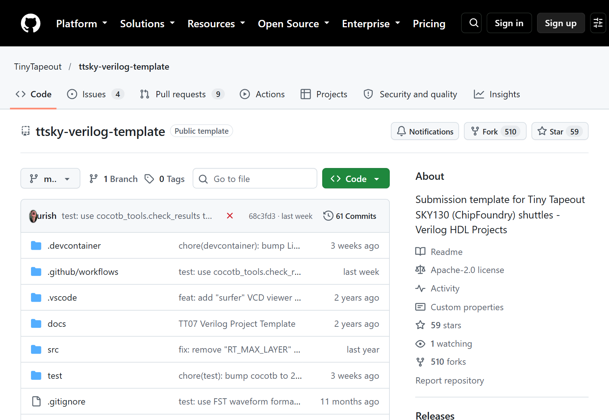

## Step 3 — Make your own repository

Sign in to GitHub. On the template page select **Use this template → Create a new repository**. Choose your account as Owner, enter a name such as `tt-counter-lesson`, select **Public**, and create the repository from the template. The default branch alone is sufficient.

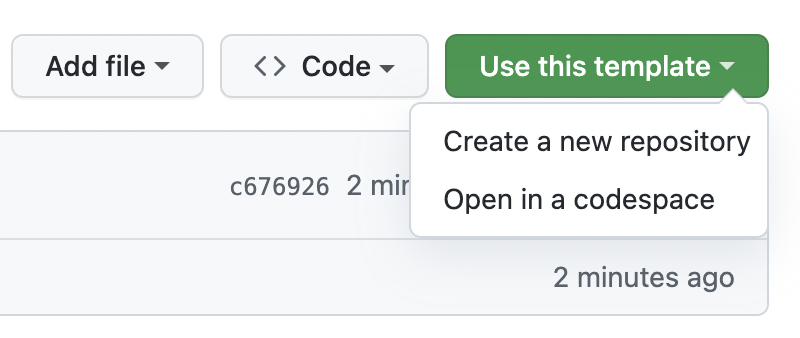

Figure: GitHub's own documentation image, showing the template menu. It is an instructional example, not a capture from our counter account. Source: [Create a repository from a template](https://docs.github.com/en/repositories/creating-and-managing-repositories/creating-a-repository-from-a-template).


Figure: official GitHub repository-name field. Enter your own repository name. Source: [GitHub template instructions](https://docs.github.com/en/repositories/creating-and-managing-repositories/creating-a-repository-from-a-template).

**Checkpoint:** the header now begins with your username, and the URL has the form `https://github.com/YOUR-USERNAME/tt-counter-lesson`. Make subsequent changes in this copy.

## Step 4 — Enable Actions and the layout results page

Open your repository's **Actions** tab. If GitHub shows an Actions enablement banner, enable the workflows. A new repository created from a template may already have Actions available.

Then open **Settings → Pages**. Under **Build and deployment**, set **Source** to **GitHub Actions**. The Tiny Tapeout template already provides the publishing workflow. Follow that workflow rather than adding a second Pages workflow.

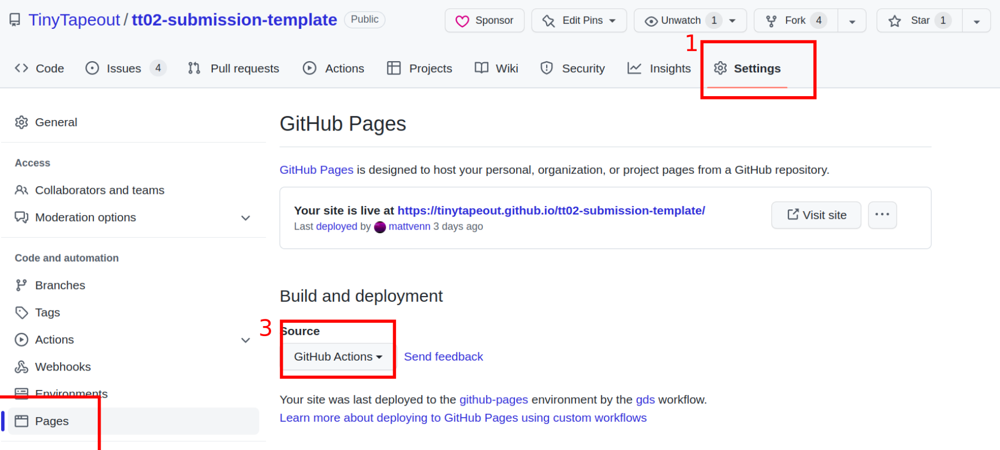

Figure: official Tiny Tapeout FAQ screenshot. Its older example repository is named `tt02-submission-template`; use the same Settings → Pages → Source control in your own current SKY repository. Source: [Tiny Tapeout Pages FAQ](https://tinytapeout.com/faq/#my-github-action-is-failing-on-the-pages-part), also supported by [GitHub's Pages instructions](https://docs.github.com/en/pages/getting-started-with-github-pages/configuring-a-publishing-source-for-your-github-pages-site).

**Checkpoint:** Source displays **GitHub Actions**. This publishes a layout-viewer website; it is separate from manufacturing submission.

## Step 5 — Extract the seven-file starter pack

Download the supplied starter ZIP and extract it on your computer. Open the extracted directory until you see `info.yaml` beside the three folders below:

```text
info.yaml
src/
    counter.v
    project.v
test/
    Makefile
    tb.v
    test.py
docs/
    info.md
```

These are exactly **seven files**: two in `src`, three in `test`, one in `docs`, and one at the root. The template's `.github/workflows`, `.devcontainer`, `test/requirements.txt`, licence and process configuration remain supplied by the template.

| File | What it does |
|---|---|
| `src/counter.v` | Implements counting, synchronous reset, hold and the terminal-count flag. |
| `src/project.v` | Connects that counter to Tiny Tapeout's required top-level ports. |
| `info.yaml` | Gives the project title, module name, clock target, source list and pin descriptions. |
| `test/Makefile` | Tells the simulator which Verilog files to compile. |
| `test/tb.v` | Instantiates the top module and exposes its ports to the Python test. |
| `test/test.py` | Drives the inputs and checks reset, count, hold, overflow and wrap behaviour. |
| `docs/info.md` | Provides the text for the generated datasheet. |

**Checkpoint:** `counter.v` is a real Verilog text file, not `counter.v.txt`; `info.yaml` is beside `src`, rather than inside it. Windows File Explorer's **View → Show → File name extensions** helps check this.

## Step 6 — Upload the complete example in one browser commit

Return to your repository's **Code** tab and its root file list. Select **Add file → Upload files**. Drag **`info.yaml` and the `src`, `test` and `docs` folders** from inside the extracted starter directory into the upload page. Dragging the folders preserves their paths. Inspect the displayed upload paths before committing.


Figure: official GitHub upload-control image. Source: [Adding a file to a repository](https://docs.github.com/en/repositories/working-with-files/managing-files/adding-a-file-to-a-repository).

The upload should contain `src/counter.v`, `src/project.v`, `test/Makefile`, `test/tb.v`, `test/test.py`, `docs/info.md` and root `info.yaml`. It replaces the template example files at those paths and adds the counter module. If the paths start with an extra starter-pack directory, return to the extracted directory and drag its contents instead.

Enter a commit message such as **Add eight-bit counter lesson**. For this personal practice repository, choose **Commit directly to the main branch**, then save the changes. A repository with branch rules may require **Propose changes** and a pull request instead; use its required route to get the complete seven-file change onto the intended branch.

**Checkpoint:** the root file list still contains the original template infrastructure, and `src` contains both `project.v` and `counter.v`. The commit identifier beside the file list identifies this saved version. Each commit starts workflows in the current template.

### Alternative: enter or replace each file in the browser editor

Use this if folder upload is inconvenient. For the six existing files, open the file and select the **pencil** to edit it. Click inside the editor, replace the contents with that file's complete appendix source, then select **Commit changes…** and save to the intended branch. For the new counter file, open `src`, select **Add file → Create new file**, name it `counter.v`, paste its complete source and commit.

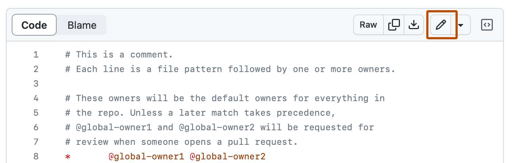

Figure: official GitHub edit-file control. Source: [Editing files](https://docs.github.com/en/repositories/working-with-files/managing-files/editing-files).

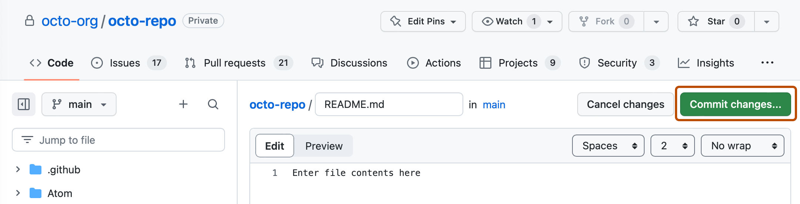

Figure: official GitHub editor image showing the button that opens the commit form. Source: [Creating new files](https://docs.github.com/en/repositories/working-with-files/managing-files/creating-new-files).


Figure: official GitHub branch-choice example; it shows the new-branch option selected. For this simple personal exercise select the direct-to-main option, subject to your repository's rules. Source: [Editing files](https://docs.github.com/en/repositories/working-with-files/managing-files/editing-files).

Editing one file at a time creates several saved versions. Early runs may fail while the set is incomplete. Judge the runs for the final commit after all seven files are present.

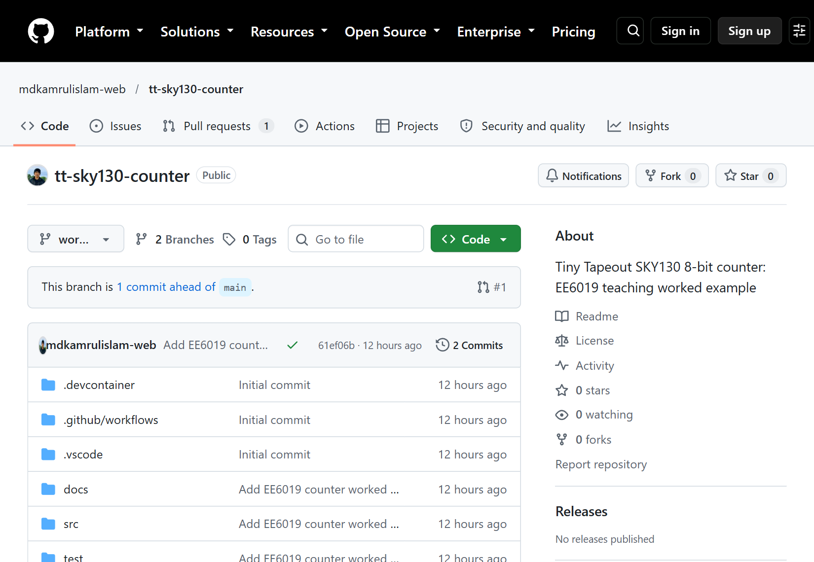

## Step 7 — Check the two source lists and the three module-name locations

Open `info.yaml`. Under `project`, the starter has meaningful title, author and description text, a 50 MHz clock target, and a `1x1` tile. Its source list is:

```yaml
  source_files:
    - "project.v"
    - "counter.v"
```

Both files live inside `src`, so these entries are their filenames. Open `test/Makefile` and confirm:

```make
PROJECT_SOURCES = project.v counter.v
```

The top-module name in `src/project.v`, `project.top_module` in `info.yaml`, and the module instantiated as `user_project` in `test/tb.v` must match. The provided example uses `tt_um_mdkamrulislam_counter` in all three. The inner module in `counter.v` is named `counter`; that is a different module.

For a first exact reproduction, use the supplied matching names. For your own extension, choose a unique Verilog-safe name beginning `tt_um_`, such as `tt_um_studentname_counter`, and update all three locations. Use letters, digits and underscores. Preserve the required port names, widths and directions. `ui_in[0]` is this counter's enable; `ena` is the separate Tiny Tapeout project-selection signal. [Tiny Tapeout interface requirements](https://tinytapeout.com/hdl/important/).

The pin labels in `info.yaml` describe what readers will see in the datasheet. They do not wire the circuit. The actual connections are in `project.v`.

**Checkpoint:** both source lists include `counter.v`; all three top names agree; the wrapper has the eight template ports, including `ena`, `clk` and `rst_n`.

### Understand each setting before you change it

`info.yaml` is a structured text file. YAML uses indentation to group values. Keep spaces and the same nesting as the complete example; do not insert tabs for indentation. A colon separates a key from its value. Quotation marks allow descriptive text. The list beneath `source_files` uses one dash per filename.

| Field | Why it exists | What to use and how to check |
|---|---|---|
| `title` | Identifies the project in documentation | Meaningful, non-empty text; check the datasheet heading |
| `author` | Credits the project author | The starter credits the reference author; identify your adaptation accurately when personalising |
| `description` | Gives readers a one-line behaviour summary | Say counter, enable, reset and flag; avoid a description that contradicts the RTL |
| `language` | Identifies the source language | `Verilog` for this example |
| `clock_hz` | Documents the intended clock rate | `50000000` means 50 million cycles per second; the reference uses a matching 20 ns physical constraint |
| `tiles` | Declares requested design space | `1x1` for the verified example; increasing it has later cost and integration consequences |
| `top_module` | Tells tools which hardware module is the outside of your project | Must match the declaration in project.v and the instance in tb.v |
| `source_files` | Supplies the physical flow's source-file list | `project.v` and `counter.v`, both actually inside src |
| `pinout` | Describes the fixed interface in the datasheet | Keep every required pin key; name used pins and leave unused labels blank |
| `discord` | Optional contact/role information | The example leaves it empty; it is not needed to understand or reproduce the circuit |
| `yaml_version` | Selects the expected metadata schema | Keep `6` for the reference schema; follow a future template's instructions if its schema changes |

Pin descriptions do not create electrical connections. Changing `uo[0]` to “load” only changes documentation; it does not make it an input or add a load function. The Verilog port directions and assignments implement the hardware. Check the metadata against the wrapper's pin mapping rather than inventing names independently.

The current `src/config.json` includes `CLOCK_PERIOD: 20` in nanoseconds. This agrees with the 50 MHz declaration and the Python test's 20 ns clock. Metadata, simulation and physical constraints are separate representations that should agree. If a future experiment changes the operating target, review each representation deliberately and read the generated timing constraint; do not assume editing a label changes all the others.

For the first example, keep the template's process configuration and workflows. The starter ZIP deliberately excludes them. Those files contain integration choices and tool settings beyond the counter's behaviour. A copied web command from the repository's separate background LibreLane flow is not interchangeable with this Tiny Tapeout template.

### Give the datasheet enough information to use the circuit

Open `docs/info.md`. It is Markdown: headings begin with `#`, lists begin with a dash and fenced code blocks are surrounded by three backticks. The documentation workflow combines this text with project metadata to produce a PDF.

**How it works** should describe what the circuit does, including the fact that reset is synchronous and active low at the wrapper. **How to test** should explain which pins to drive and which output to expect. **External hardware** should state that no hardware is needed for simulation and that a later board experiment needs a controlled clock and appropriate input handling.

A useful datasheet statement is: “After a reset edge, set ui_in[0] to 1; each rising clock edge increments the binary count. Set it to 0 to hold.” A vague statement such as “this is a counter” is insufficient for someone trying to use it.

**Check:** the pin table names count bits and wrap consistently, the test procedure predicts observable values, and the generated PDF contains meaningful text. This documentation is also part of why the initial empty template's docs job failed: title, author, description and datasheet content needed completing. That was a real metadata failure, not evidence that the final counter test failed.


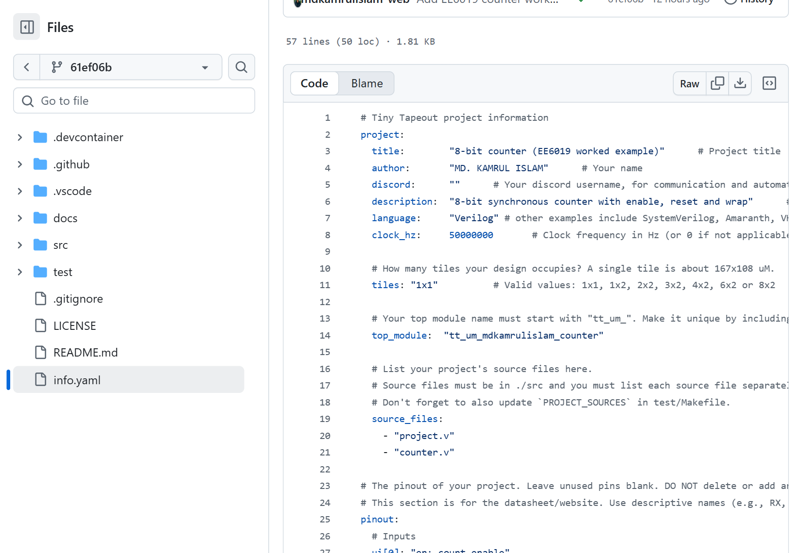

## Step 8 — Read the test before relying on a green icon

Open `test/test.py`. It starts a 20 ns clock, corresponding to 50 MHz. Its `step()` helper waits for a falling edge, sets enable and reset, waits for the next rising edge, then allows 8 ns for outputs to settle. It compares the outputs against a Python model.

The checks cover initial reset, hold, counting through more than 256 increments, overflow, a later reset, reset priority, and disabling enable at terminal count. They also check the unused output bits and `uio_oe`. The same top-level-port checks work on both the RTL and the mapped cell netlist.

Example reasoning: after reset the expected count is 0. One enabled rising edge makes it 1. A disabled rising edge leaves it at 1. When an enabled edge takes count from 254 to 255, `wrap` becomes 1; the next enabled edge takes count to 0 and `wrap` becomes 0. [Complete verified test](https://github.com/mdkamrulislam-web/tt-sky130-counter/blob/61ef06bed008e76000f9ae46d65182e476d15dd6/test/test.py).

## Step 9 — Check the `test` workflow for your final commit

Select **Actions**, then **test** in the left-hand workflow list. Open the run corresponding to your final commit. Check its branch and commit identifier. Open the **test** job and expand **Run tests** to read the simulator output.

A completed successful run should show a passing test summary. Our verified example produced **1 test, 0 failures, 0 errors**, with 11,368 ns of simulated time. Your run has its own commit identifier and run number. The current workflow explicitly checks `results.xml` after `make`, because a successful `make` exit alone is insufficient. [Current test workflow](https://github.com/TinyTapeout/ttsky-verilog-template/blob/main/.github/workflows/test.yaml).

Our actual successful reference run is [test run 37693100752](https://github.com/mdkamrulislam-web/tt-sky130-counter/actions/runs/37693100752) at `61ef06b`.

**Checkpoint:** the test passed for the commit containing your complete example, rather than an earlier template version.

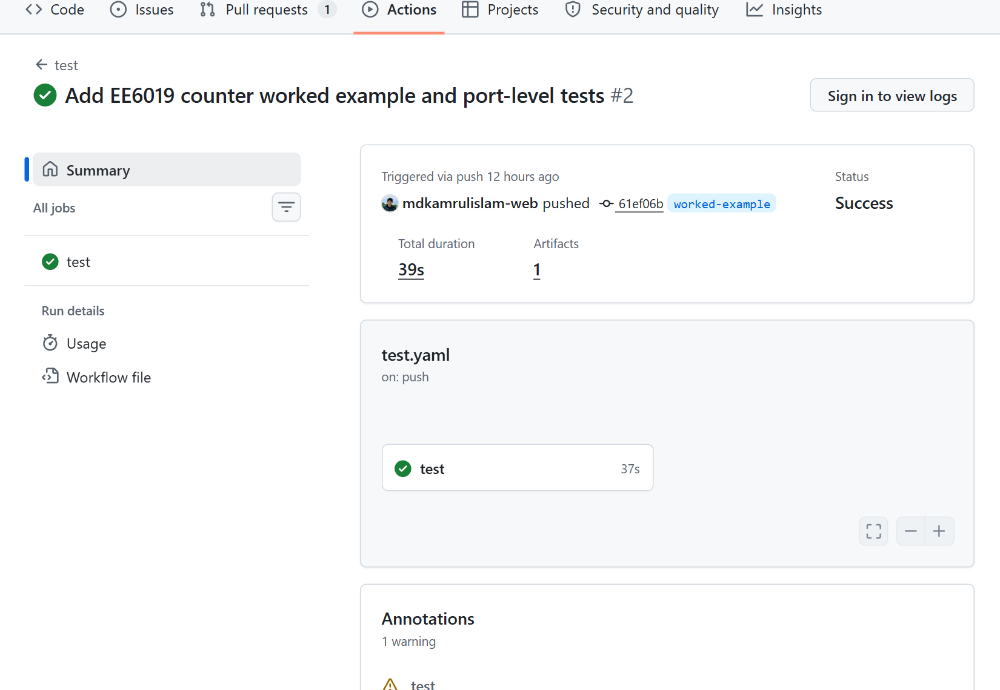

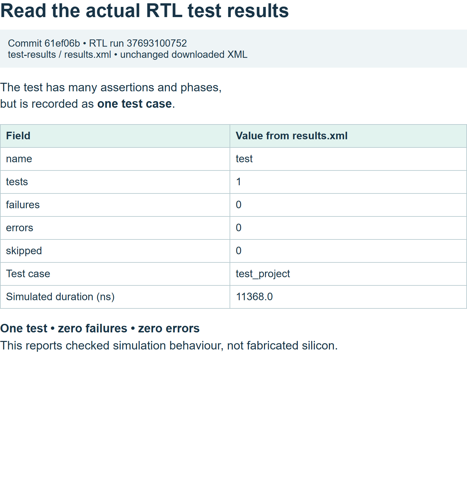

## Practical step: open and read your real waveform

**Why:** assertions tell you whether the sampled values matched the model. A waveform shows how the signals changed over time, helping you connect the specification, code and clock edges. It is also useful when a test fails, but this example's test passed.

**Do:** in your successful `test` run, return to Summary, scroll to Artifacts and download `test-results`. Extract the ZIP. Find `tb.fst` and `results.xml`. Do not drag the ZIP itself into the viewer.

Open [Surfer's free web viewer](https://app.surfer-project.org/). Drag the extracted `tb.fst` from File Explorer or your file manager onto its canvas. Allow loading to finish. A `tb` scope and the filename in the status bar indicate the file has loaded; an empty wave area can simply mean that no signals have been added yet.

Press **Space** to open the command palette, type `scope_add tb`, then press **Enter**. This adds the testbench's top-level signals. Press Space, enter `zoom_fit` and press Enter to see the whole test. You can also expand the `tb` scope and add individual signals. The relevant signals are `clk`, `rst_n`, `ui_in`, `uo_out`, `uio_out` and `uio_oe`; `ena` should be high.

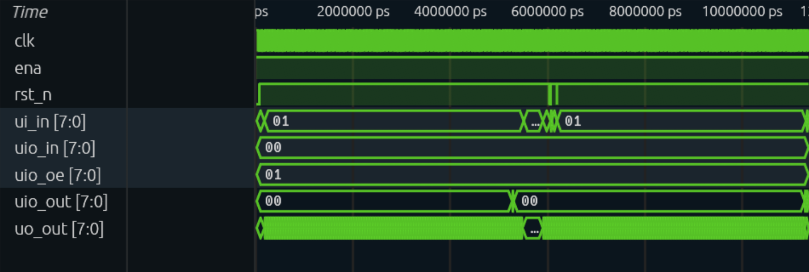

The values in these captures use hexadecimal for buses: `00` is zero, `01` is one, `0a` is ten, `fe` is 254 and `ff` is 255. One hexadecimal digit describes four bits, so two digits describe this eight-bit bus. You can use the viewer's format control to choose another radix; the stored waveform data does not change.

The reference FST's base time unit is picoseconds. **1 ns = 1,000 ps.** An axis label of `5,280,000 ps` therefore means 5,280 ns. Entering explicit `ns` in the following zoom commands avoids confusion. Your modified test may have different times, so search for the same event rather than blindly using the author's time coordinates.

### Observe reset and the first increments

Press Space, type `zoom_to 0ns 300ns`, press Enter.


**Check:** the count is zero after reset edges, remains zero during disabled edges, and starts increasing only on enabled rising edges. The test changes inputs at falling edges. This gives a clear interval before the next sampling edge. If you see a dense block instead of values, zoom in further.

### Observe 254 → 255 → 0

Press Space, type `zoom_to 5200ns 5340ns`, press Enter.

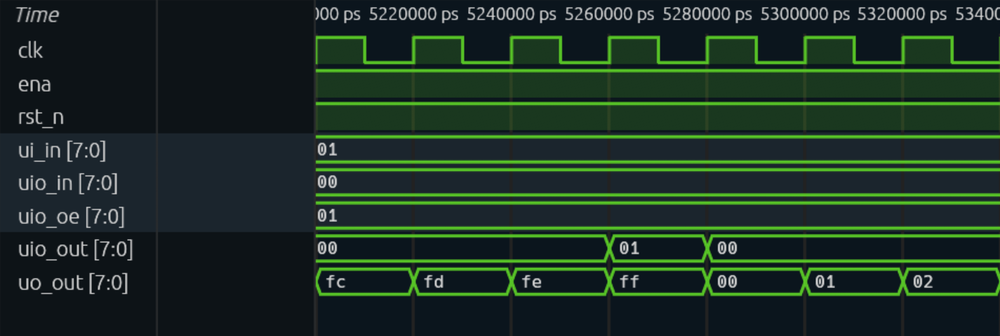

**Check:** the flag rises when the count reaches 255 and falls when the count becomes zero. It is a terminal-count indication before the overflow edge, not a registered pulse after overflow. The `uio_oe` bus is `01`, enabling only its least-significant pin as an output.

### Observe hold while the clock continues

Press Space, type `zoom_to 5460ns 5880ns`, press Enter.

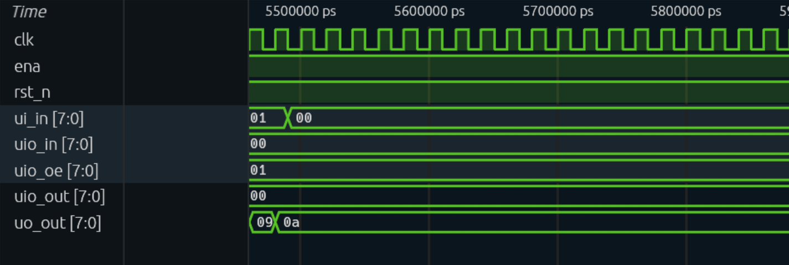

**Check:** count stays at 10 after enable is disabled, although clock edges continue. This connects the missing `else` assignment in the clocked RTL to real register hold behaviour.

### If the waveform does not appear

Confirm that you extracted `tb.fst`, not `results.xml` or a ZIP. Wait for file loading, then add signals. `zoom_fit` restores the full time range if you have scrolled away. For a modified test, use the signal transitions to locate events instead of the reference times. Surfer's browser `load_file` command cannot accept a local filesystem path; use drag and drop. A native GTKWave or Surfer installation is an optional alternative, described in the local appendix.

Keep the original FST and XML with the run URL and full commit. The figures above are native captures of genuine simulation output; the hand-prediction tables in Part 1 serve a different teaching purpose.

Source: [Surfer command documentation](https://docs.surfer-project.org/book/commands/index.html), [official Surfer web entry](https://surfer-project.org/), [the actual test run](https://github.com/mdkamrulislam-web/tt-sky130-counter/actions/runs/37693100752).


## Step 10 — Check the documentation and download the datasheet

Open `docs/info.md` from **Code**. The Markdown headings **How it works**, **How to test** and **External hardware** contain the example description. The root `info.yaml` supplies the project metadata and pin names.

Select **Actions → docs**, then the run for your final commit. Once it completes, return to the run's **Summary** and scroll to **Artifacts**. Download the **PDF** artifact, extract it and open `datasheet.pdf`. GitHub requires a signed-in account to download workflow artifacts.

Our [successful docs run 37693100755](https://github.com/mdkamrulislam-web/tt-sky130-counter/actions/runs/37693100755) generated a two-page datasheet. Check your project's title, pin descriptions, reset timing, count/wrap explanation and test instructions in your own PDF. The documentation describes the circuit; it is not proof that the circuit passed simulation.

**Checkpoint:** your generated PDF has meaningful text and agrees with the source and pin assignments.

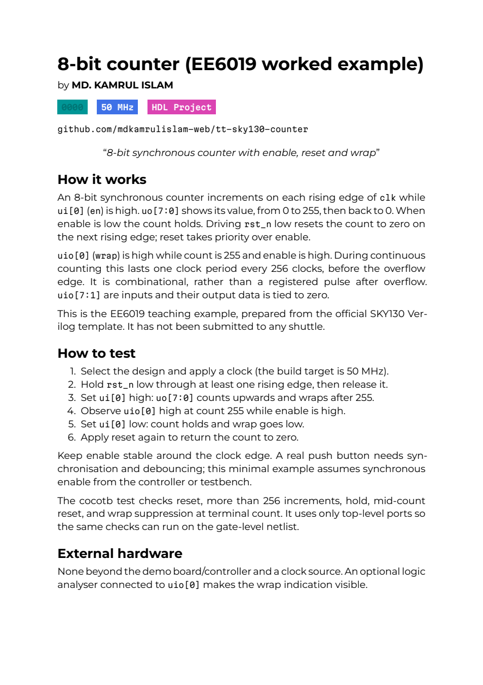

## Step 11 — Wait for all four jobs in the `gds` workflow

Select **Actions → gds**, then the run for your final commit. A queued or running job is still in progress. The four jobs are:

| Job | What a successful result establishes |
|---|---|
| `gds` | The flow produced the physical layout and its reports. |
| `gl_test` | The counter's functional test passed using the generated cell netlist. |
| `precheck` | The Tiny Tapeout checks completed on the generated design. |
| `viewer` | The layout-viewer files were published through Pages. |

Open a job in the left sidebar to see its individual steps. Expand a step to read its log. A red job means investigate its first useful error. A downstream job may be skipped because `gds` failed; fix that earlier cause first.

Our [GDS run 37693100748](https://github.com/mdkamrulislam-web/tt-sky130-counter/actions/runs/37693100748) passed all four jobs at commit `61ef06bed008e76000f9ae46d65182e476d15dd6`. Its gate-level test also produced 1 test with no failures or errors. Functional gate-level simulation checks behaviour with cell models and unit delays. Timing checks in the hardening reports assess speed; the functional test is not an SDF-annotated timing simulation.

**Checkpoint:** all four jobs passed for your current example commit. The template's optional FPGA workflow is a separate exercise.

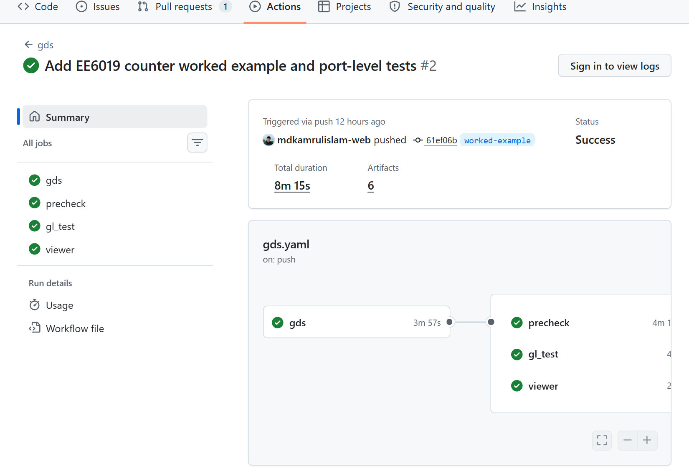

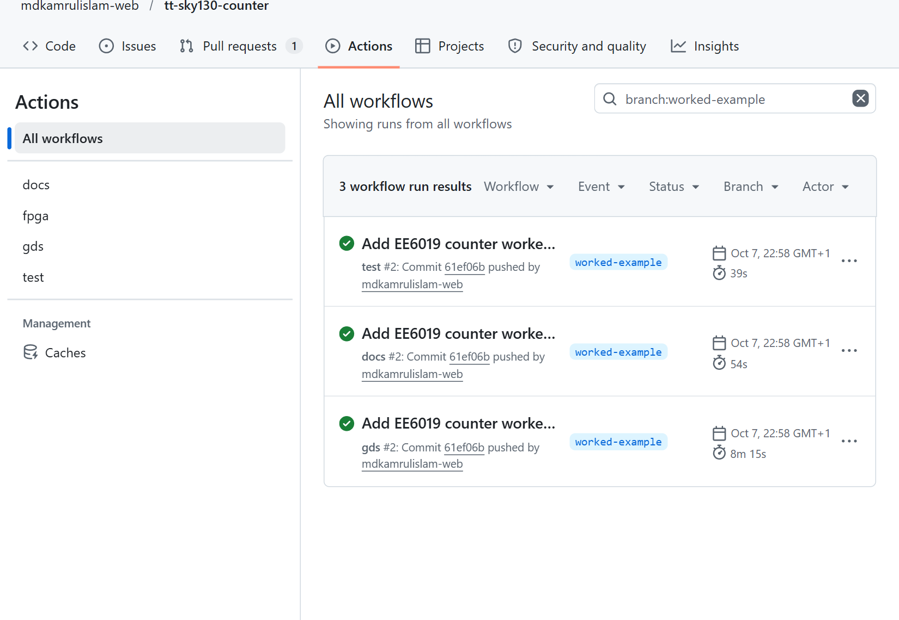

## Step 12 — Open and explore the layout

After `viewer` succeeds, open **Settings → Pages → Visit site**, or use the site URL shown there. A project site normally has the form `https://YOUR-USERNAME.github.io/YOUR-REPOSITORY/`. The published example is [our counter viewer](https://mdkamrulislam-web.github.io/tt-sky130-counter/).

Allow the layout to load. Use the viewer's mouse controls and on-screen **KEYS** instructions to pan, rotate and zoom. In **Controls → View Settings**, the **Filler cells** checkbox can hide filler cells and make the active circuitry easier to find. Use the layer controls to explore different layout layers.

The layout shows geometric layers, not a photograph of a fabricated chip. The example's logic is clustered near the top, with power rails crossing the tile. A visually attractive layout still needs the tests and checks already examined.

**Checkpoint:** the viewer shows your top-module name and a loaded layout. If the WebGL view is blank, inspect the genuine `gds_render` image downloaded from the run while troubleshooting the browser.

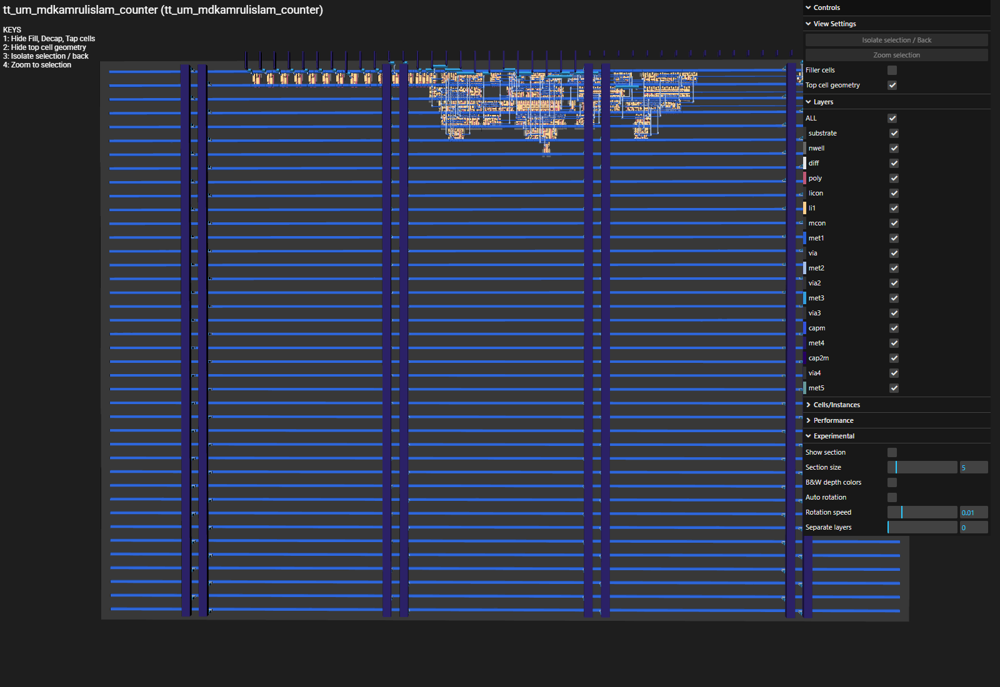

## Step 13 — Download the evidence, not just a screenshot

On the completed **gds** run, select **Summary** and scroll to **Artifacts**. Click the required artifact name. Extract its ZIP on your computer. Our verified run exposes these names:

| Artifact | Useful contents |
|---|---|
| `gds_render` | The generated two-dimensional layout image `gds_render.png`. |
| `tt_submission` | The layout, mapped Verilog, process metadata, commit identity and statistics. |
| `GDS_logs` | Detailed hardening logs and intermediate reports. |
| `gatelevel_test_results` | Gate-level `results.xml` and waveform evidence. |
| `precheck_reports` | The precheck results. |
| `github-pages` | The published viewer files, packaged for Pages. |

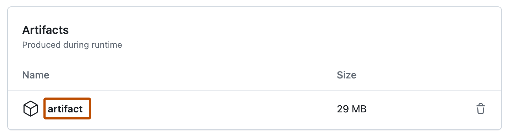

Figure: official GitHub artifact-download control. Its generic artifact is named `artifact`; the Tiny Tapeout run uses the names in the table above. Source: [Download workflow artifacts](https://docs.github.com/en/actions/how-tos/manage-workflow-runs/download-workflow-artifacts).

In the `tt_submission` download, look inside its `tt_submission` folder for your `.gds`, `.oas`, `.v`, `commit_id.json`, `pdk.json`, and `stats/metrics.csv` / `stats/synthesis-stats.txt`. The folder may be wrapped by the download/extraction tool; follow the contained tree. Save the commit identifier and run URL beside the files.

In the separate **test** run, the `test-results` artifact contains `results.xml` and the RTL waveform `tb.fst`. In the **docs** run, the `PDF` artifact contains the datasheet. Artifacts can expire under repository retention settings, so download the evidence you intend to keep. [GitHub artifact downloads](https://docs.github.com/en/actions/how-tos/manage-workflow-runs/download-workflow-artifacts).

## Step 14 — Interpret the real counter's measurements

These are the verified example's results from the same `61ef06b` run, rather than promises for every future build:

| Measurement | Verified example | How to read it |
|---|---|---|
| Synthesised cells | 47 | Cells after synthesis; this is not a count of individual logic gates. |
| Non-fill standard-cell instances | 279, including 225 taps | The final layout adds physical implementation cells. |
| Total instances | 4,600, including 4,321 filler cells | Filler instances are not extra counter logic. |
| Core utilisation | 4.96131% | Reported non-fill cell area as a fraction of available core area. |
| Clock target | 50 MHz | The target used for this build. |
| Worst setup / hold slack | +8.64285 ns / +0.109636 ns | Positive margins in the reported timing checks. |
| Setup / hold violations | 0 / 0 | No reported violations for those checks. |
| Magic DRC / LVS errors | 0 / 0 | No reported errors in these manufacturing/connectivity checks. |

Our precheck artifact passed all 15 checks. The recorded lint report has 0 errors and 447 `TIMESCALEMOD` warnings arising from the inherited timescale and generated cell modules. Review and classify warnings; a green run does not mean every warning count is zero. Compare your results with the reports from your own commit.

## Step 15 — Troubleshoot one cause at a time

| Symptom | What to inspect | Next action |
|---|---|---|
| First runs fail just after repository creation | Empty template metadata or incomplete source set | Finish all seven files, then inspect the final commit's runs. Our genuine first template failure was empty metadata. |
| No Actions run appears after saving | Actions enablement and whether the change was committed | Open Actions, enable workflows if prompted, and confirm the file list shows the new commit. |
| Unknown module / missing Verilog file | Both source lists and the three top-name locations | Correct filenames or the mismatched name, commit, and inspect the new run. |
| Documentation validation fails | `info.yaml` title/author/description, pin labels and `docs/info.md` sections | Supply meaningful values and descriptions. Keep the YAML nesting and existing pin keys. |
| A counter assertion fails | First failed assertion, expected value, reset and enable at the clock edge | Work out the expected next count and check the corresponding inputs. Preserve the assertion while fixing its cause. |
| RTL passes but `gl_test` fails | Gate-level log and the test's drive/sample timing | Use the same top-level ports; allow outputs to settle after the rising edge as the supplied helper does. |
| `viewer` fails | Pages Source and the first deployment error | Set Source to GitHub Actions. Start a fresh full GDS run once the setting is fixed if needed. |
| Viewer rerun reports multiple `github-pages` artifacts | Whether only `viewer` was rerun after enabling Pages | Follow the Tiny Tapeout FAQ: create a fresh complete workflow run rather than repeatedly rerunning that old viewer job. |
| Layout view is blank | Whether `viewer` passed, the site finished loading, and browser WebGL support | Try a browser with WebGL available; inspect the downloaded `gds_render` PNG in the meantime. |
| Placement/routing or timing fails after an extension | The first flow error and actual area/timing reports | Simplify the extension or discuss an appropriate tile/clock target with staff; use the template's process settings. |

To start a fresh run deliberately, open **Actions**, choose **gds** on the left, select **Run workflow**, choose the intended branch and select **Run workflow** in that menu. This requires write permission and uses the current files on the selected branch. Repeated reruns of unchanged code do not fix a deterministic source error. [Tiny Tapeout workflow troubleshooting](https://tinytapeout.com/faq/#my-viewer-job-fails-after-enabling-github-pages-and-rerunning-it-on-an-existing-gds-action).

## Step 16 — Choose whether you need local simulation

The main route is complete without local tool installation. If you want faster edit/test cycles on an Ubuntu or managed lab environment, Appendix B gives the setup, commands, expected outputs and troubleshooting. It includes the required XML results checker. Use the main Actions gl_test job for the first gate-level result.

## Step 17 — Make a small extension after the example passes

Choose one change: a count-down counter or a parallel-load counter. Write the expected behaviour first. For count-down, define whether 0 wraps to 255. For load, define which input pins supply the load value and whether reset, load or enable has priority. Keep the Tiny Tapeout top interface fixed.

Update the RTL, metadata/pin labels, Python model and datasheet together. Add checks for the new transition and boundary cases. Commit, then inspect that commit's `test`, `docs` and all four `gds` jobs. Record the new cell count and utilisation from that same run. A screenshot from the unmodified example is not evidence for the extension.

## Step 18 — Finish the free exercise here

Save your repository link, commit identifier, successful run links, datasheet, test results, waveform, layout files and relevant reports. You now have a documented, tested physical design example.

Manufacturing is a later decision: an order and an explicitly submitted design revision are separate from these GitHub builds. A later GitHub commit does not automatically replace a previously submitted fabrication revision. For this exercise, retain the evidence and stop before the order/submission steps. [Tiny Tapeout submission guide](https://tinytapeout.com/guides/advanced-workshop/submit-your-design/).

# Part 3 — Understand what the layout build actually did

You now have a repository and automated runs. This part explains the hidden work between Verilog and the layout. Read it with your GDS run open. The tools perform these stages automatically; your job is to understand the inputs, read the results and decide whether the evidence supports your specification.

## 3.1 From behaviour to actual gates: synthesis

Verilog says what the counter should do at a rising edge. It does not draw eight flip-flops or specify a particular manufacturer's adder cells. **Synthesis** turns the supported hardware description into a network of cells from a technology library. A cell is a pre-designed circuit such as a flip-flop, inverter or logic gate, with known electrical and physical properties.

For the counter, synthesis needs storage for the eight count bits and logic to choose reset, hold or increment. The reduction AND that detects an all-ones count also becomes logic. Optimisation can share logic or choose a different arrangement of cells while preserving the described behaviour. Do not expect one Verilog statement to become exactly one cell.

The output is a **netlist**: named cell instances and the wires connecting them. It still needs physical positions and routed wires. In the reference run, the synthesis report contains 47 cells. This is a reported result of that particular source, library and tool version, not a silicon measurement or a universal size for every 8-bit counter.

**Do:** open the GDS job logs or downloaded `GDS_logs` artifact and locate the synthesis summary. Search for `Yosys`, `synthesis` or cell statistics. **Check:** no synthesis error or unmapped-cell error is reported, and a netlist is produced. **Why:** unsupported constructs, wrong top modules or missing files can prevent a real circuit being generated even if the text looks plausible.

## 3.2 The PDK: the rules for a particular manufacturing process

A **process design kit**, or PDK, tells the tools how a manufacturing process is represented: layers, rules, device models and other technology information. The standard-cell library supplies reusable digital circuits characterised for that process. The example selects SKY130 and its high-density standard cells through the official SKY template.

“130 nm” names a process generation; it does not mean every rectangle in the final layout is 130 nm wide. Different layers have different rules. You cannot take a finished SKY130 layout and label it IHP merely by changing a filename. Selecting another technology requires its template and libraries, followed by new builds and checks.

**Check:** the run identifies `sky130A` and the intended standard-cell library. Record the PDK and tool versions with the commit. **Why:** these choices affect the cells, geometry and timing. A result without that context is hard to reproduce.

## 3.3 Floorplanning: choose the usable space and place the interfaces

**Floorplanning** establishes the design boundary, usable core, pin positions, rows for cells and the plan for power connections. Tiny Tapeout's template supplies a constrained tile and a fixed interface, so students do not begin by drawing an arbitrary chip outline.

Imagine arranging a small classroom model: the floorplan says where the room boundary and doors are before you place desks. The analogy only explains planning; physical-design tools also obey precise electrical and manufacturing rules.

Do not confuse this tile with the entire shared chip. The shared chip also contains other designs and selection infrastructure. The reference counter's utilisation is the percentage reported for its core, not a percentage of the whole manufactured chip or a count of gates.

## 3.4 Placement: put the cells in legal positions

**Placement** chooses positions for the synthesised cell instances. Related cells should be connected without excessive wire length, but they must also fit into legal rows and leave enough room for wiring. A mathematically small netlist can still be awkward to place or route.

The reference run reports 4.96131% core utilisation. Here that is the non-filler standard-cell area divided by core area: approximately 818.285 square micrometres / 16,493.3 square micrometres × 100. The counted area includes physical support cells such as taps, so it is not a logic-only percentage. It does not mean the remaining 95% is entirely available for any new circuit: routing, pins, clocking, power, required physical cells and the flow's constraints also matter.

**If placement fails:** first confirm the intended design and tile configuration, then read the exact error. A larger tile has a later financial consequence and needs a new run. Changing density or placement settings without understanding the error can move the failure to routing or timing. Do not change a setting solely to hide a red job.

## 3.5 Clock-tree synthesis: distribute the clock

The Verilog model presents one clock signal to all count bits. On silicon, wires and loads mean the clock cannot reach every flip-flop at exactly the same instant. **Clock-tree synthesis**, often shortened to CTS, inserts and arranges buffers to distribute the clock with controlled delay and skew.

**Skew** is the difference between clock arrival times at two storage elements. It affects the time available for data to travel and settle. This is one reason timing must be checked after implementation, rather than inferred from a clean RTL simulation.

Clock-tree cells also explain why a physical instance count can differ from a synthesis cell count. Additional implementation cells are not automatically extra functionality in your specification.

## 3.6 Routing and extraction: connect the placed cells

**Routing** chooses wire paths on the process's metal layers and places vias where a connection changes layer. A via is a conductive connection between layers. The routing tools must respect spacing and width rules and avoid leaving connections incomplete.

Real wires have resistance and capacitance. **Parasitic extraction** estimates those effects from the implemented geometry, providing information for timing analysis. The word parasitic refers to the electrical effects of the physical implementation; it does not mean the wires are an error.

An **antenna check** addresses charge that can accumulate on conductors during manufacturing and damage a connected transistor gate. The name refers to this fabrication effect, rather than a radio antenna. [SKY130 antenna-rule explanation](https://skywater-pdk.readthedocs.io/en/main/glossary.html#antenna-rule-violations).

**Check:** the run completes routing with no critical disconnected pins or antenna violations. The reference records 16 disconnected pins but zero critical disconnected pins; these match its unused interface inputs. A different design still needs its own connectivity review. **Why:** a required logical connection in the netlist must become a valid physical path. A coloured screenshot alone cannot establish that every path meets the rules.

## 3.7 Static timing analysis: will data arrive in time?

The counter target is 50 MHz. Calculate its clock period before reading a report:

```text
period = 1 / frequency
       = 1 / 50,000,000 seconds
       = 20 nanoseconds
```

A flip-flop needs its input stable shortly **before** the sampling edge; this is its setup requirement. It also needs the input to remain stable for a short time **after** the edge; this is its hold requirement. Static timing analysis, or STA, checks paths against such requirements without applying every possible simulation sequence.

The tools read a **timing-constraint file**, usually called SDC, that specifies the clock and assumptions about signals entering and leaving the design. This run uses the template's generic constraints: a 20 ns clock and 4 ns input/output delays. These describe the analysed interface; they are not measurements of an attached board. A **timing corner** is a combination of process, voltage and temperature models, with a wire-extraction condition. The final summary checks several corners because cell and wire delays change with those conditions. [LibreLane timing corners](https://librelane.readthedocs.io/en/latest/usage/timing_corners.html).

For setup, a useful first interpretation of slack is the remaining time after accounting for required arrival and predicted arrival. Positive slack means that reported path meets the constraint. Negative slack means it misses the requirement. For example, a reported setup slack of −0.8 ns describes a path arriving 0.8 ns too late under those constraints. A different circuit, constraint or analysis corner can change that result.

The reference reports worst setup slack 8.64285 ns, worst hold slack 0.109636 ns and zero reported timing violations. These are flow results for the stated target and analysis conditions. They do not measure a fabricated chip's maximum operating frequency. Gate-level functional simulation in this example does not load extracted layout delays into the simulator. Such delay data can be represented in SDF (Standard Delay Format); keep the STA report as separate evidence here.

**Do:** locate the final timing summary. Record the target clock, worst setup and hold slack and violation counts. **Check:** both kinds of violation count are zero, and the report belongs to the commit you are reviewing. **If it fails:** find the failing path and determine whether the specification, RTL or constraints need a justified change. Simply making the clock slower changes the claimed performance; it does not fix a broken functional design.

## 3.8 DRC: is the geometry manufacturable under the checked rules?

**Design rule checking**, or DRC, checks geometry against process rules, such as a minimum wire width or spacing. Two unrelated wires placed too close together may violate a rule even though the RTL and netlist describe the right logic.

The reference hardening flow reports zero Magic DRC errors, plus a passing Tiny Tapeout precheck. The template disabled its KLayout DRC and XOR steps within that hardening flow; those steps did not run there. The separate precheck did run KLayout checks, including front-end geometry (FEOL), back-end wiring (BEOL), off-grid shapes and pin-label overlap. “KLayout DRC disabled in hardening” therefore does not mean KLayout was absent from all checks. Do not turn “all visible jobs passed” into a claim that every possible checker was used.

**Do:** inspect the enabled checks and their results. **Check:** zero reported violations for the required enabled checks and a passing precheck. **Why:** knowing both the result and the scope of checking is necessary for an honest sign-off record.

## 3.9 LVS: does the geometry represent the intended circuit?

**Layout versus schematic**, or LVS, compares connectivity extracted from the layout with the expected netlist. DRC can tell you that wires have legal spacing; LVS can reveal that a legal-looking wire joins the wrong nodes, or that a connection or device is missing.

Think of DRC as checking that a written address uses permitted characters, and LVS as checking that it names the intended destination. This is only an analogy. In the actual flow LVS compares circuit connectivity and device information.

The reference reports zero LVS errors. **Check:** a passing LVS result for the final implementation. **If it fails:** read the comparison output; changing the behaviour test will not repair a wrongly connected layout.

## 3.10 Precheck and gate-level simulation: two more kinds of evidence

Tiny Tapeout's **precheck** checks whether the design package follows its integration requirements. It is a separate job after GDS. All 15 checks passed in the reference run. The names and number can change with the shuttle action, so inspect your actual report rather than assuming 15 forever.

The **gate-level test** drives the implemented netlist with the same external test cases. It checks that the implementation still behaves as expected for those cases. The top-level test was deliberately written around ports, so it can be reused without depending on an internal RTL signal name that synthesis may remove.

In this template's gate-level Makefile path, PDK cell models are compiled with functional and unit-delay settings. This is useful functional checking, but it is not extracted SDF simulation or a replacement for STA. RTL simulation, gate-level simulation, STA, DRC, LVS and precheck answer different questions; none individually proves the others passed.

## 3.11 Read the actual reports and keep the units straight

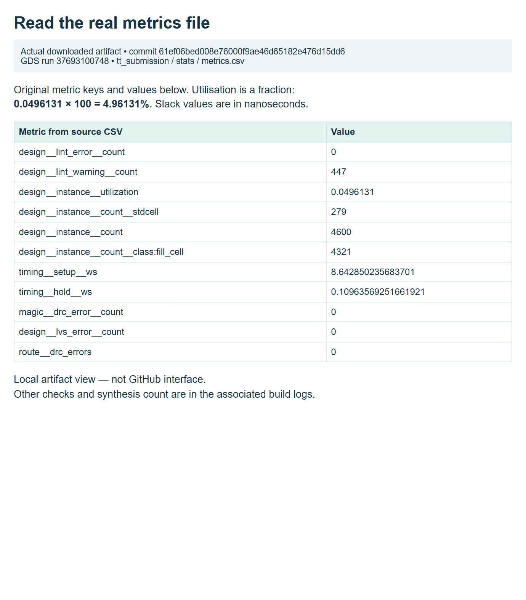

| Quantity in the reference | Reported value | What it means |
|---|---|---|
| Core utilisation | 4.96131% | Non-filler standard-cell area/core area; includes physical support cells |
| Synthesis cell count | 47 | Instances counted at synthesis |
| Final non-fill physical instances | 279 | Includes 225 taps plus logic and other implementation cells |
| Final total physical instances | 4,600 | Includes 4,321 filler cells |
| Worst setup slack | 8.64285 ns | Positive margin under reported constraints |
| Worst hold slack | 0.109636 ns | Positive margin under reported constraints |
| Reported timing, Magic DRC, LVS and antenna violations | 0 | Results of the enabled checks in this run |
| Timescale lint warnings | 447 | Warnings remain; not 447 failed assertions |

Filler cells occupy gaps for physical purposes; they are not 4,321 additional counter operations. Do not divide 4,600 by a remembered “gates per tile” estimate to decide whether the design fits. Likewise, a low utilisation figure is useful evidence, not a guarantee that every future extension will route or meet timing.

**Tap cells** provide electrical contacts to the transistor body regions, called the substrate and wells. They support the physical circuit rather than storing count bits or computing an increment. The distinction explains why 279 non-filler instances does not mean 279 counter logic gates. [SKY130 substrate and well tap cell](https://skywater-pdk.readthedocs.io/en/main/contents/libraries/sky130_fd_sc_hd/cells/tapvpwrvgnd/README.html).

The timescale warnings arise because the counter file supplies a timescale while generated/other modules do not supply one consistently. The run had zero lint errors and completed successfully, but “passed” does not mean “no warnings”. Classify a warning by its cause and effect before changing code. If you change anything, review a new commit and new run.

## 3.12 Download the artifacts and inspect the layout

**Do:** open your successful GDS run, scroll to its artifacts, download `tt_submission` and `GDS_logs`, and extract the ZIPs. GitHub may require sign-in for artifact downloads. Artifacts are retained for a limited time; archive the evidence you need while it is available.

The reference `tt_submission` extraction contains a submission folder with a GDS file, an OASIS file, a Verilog netlist and a `stats/metrics.csv` file. Folder nesting may differ when a future action packages them. Search by filename extension if you do not immediately see them. Do not confuse the artifact's name with an actual submission to a shuttle.

**GDSII** and **OASIS** are geometry formats. A **netlist** describes connected circuit instances. `metrics.csv` is a table of run measurements. None of these is a Python program to run as the counter, and none is a physical device.

The layout's coloured shapes represent patterns on manufacturing layers, such as device regions, contacts and metal wiring. The 3D viewer stacks those drawings to help you inspect their relationships. A foundry uses the layout data in its manufacturing preparation; opening the viewer does not manufacture those shapes.


Keep an evidence directory like this:

```text
evidence/
  identity.txt        repository URL, branch, full commit, run URLs, versions
  rtl-test/           results.xml and tb.fst from your test run
  layout/             extracted tt_submission files
  build-logs/         extracted GDS_logs
  datasheet/          generated PDF
  observations.txt    conclusions, warnings, limitations and changes
```

For the 3D view, open the link published by the successful `viewer` job or your repository's Pages site. The reference is [the actual counter viewer](https://mdkamrulislam-web.github.io/tt-sky130-counter/). The page can take time to load and process the OAS file; an empty canvas during loading is not evidence that the counter is empty.


**Do:** rotate and zoom the view, then toggle the fill/decap/tap display. **Check:** the correct module is loaded and the layout appears. **Why:** this viewer toggle hides fillers, decoupling cells and taps together, making the counter logic and routes easier to see. A decoupling cell provides capacitance for the power supply; it is another support cell rather than counter logic. The viewer can refit the camera when the display changes, so two pictures should not be treated as exact pixel-area comparisons.

Write one observation in your evidence note, such as “the layout exists and the viewer loaded the intended module”. Support stronger claims with the corresponding reports, not the picture alone.

Sources: [LibreLane overview](https://librelane.readthedocs.io/en/stable/), [the exact reference GDS run](https://github.com/mdkamrulislam-web/tt-sky130-counter/actions/runs/37693100748), [Tiny Tapeout GDS action](https://github.com/TinyTapeout/tt-gds-action/tree/ttsky26d).


# Part 4 — Finish the free work and understand fabrication

## 4.1 Your free stopping point: a checked, archived revision

The free practical exercise is finished when you can show the items below for the same source version. An unchecked coloured layout or one green test is an intermediate result, not this final evidence package.

| Requirement | Evidence to keep | Question you should be able to answer |
|---|---|---|
| A clear specification | Counter behaviour and pin table | What should reset, enable and wrap do? |
| Complete, matching source | Repository URL and full commit ID | Which exact version did the runs use? |
| Functional RTL test | Passing test run, results.xml and tb.fst | Which cases were checked and what did the wave show? |
| Physical implementation | Passing gds job and downloaded GDS/OAS | Which process, tile and clock target were used? |
| Timing and physical checks | Logs, metrics, enabled-check results | What are the worst margins and remaining warnings? |
| Integration and netlist checks | Passing precheck and gl_test | Did the package and implemented behaviour pass? |
| Published viewer | Successful viewer job and site URL | Does the intended module's geometry load? |
| Documentation | Generated datasheet PDF | Do the title, pin labels and instructions match the circuit? |

**Do:** write the full commit and all three run URLs in `identity.txt`, download the artifacts and record the warnings. Use your own run identifiers, not the author's numbers. **Check:** the source version agrees across RTL, docs and GDS. If you committed a change after one run, review or rerun the checks for the new version before archiving a final package.

You can present this package to a demonstrator without buying silicon. You have learned how to prepare, implement and check a small ASIC. The remaining manufacturing decision belongs to the class or project owner and requires its budget, chosen shuttle and review process.

## 4.2 See the cost boundary without placing an order

The public [Tiny Tapeout calculator](https://app.tinytapeout.com/calculator) lets you explore the difference between design space and delivered hardware. Merely viewing the calculator is a learning activity. This manual does not ask you to request a quote, create a project order, use a coupon, pay or submit a revision.

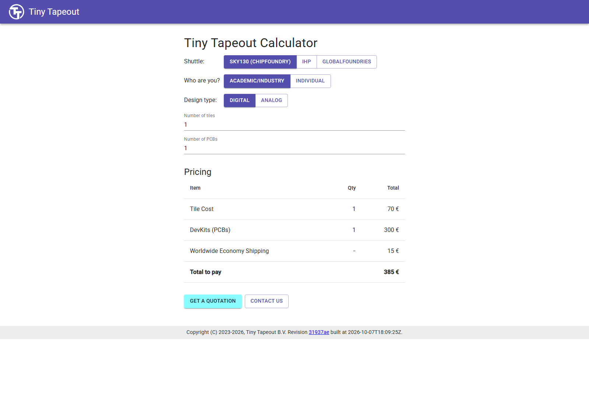

In that dated example, a tile is €70, a development kit is €300 and economy shipping is €15. Adding them gives €385. The point of the example is the distinction between buying room for a design and receiving hardware to use it, rather than a promise that your class will pay those amounts.

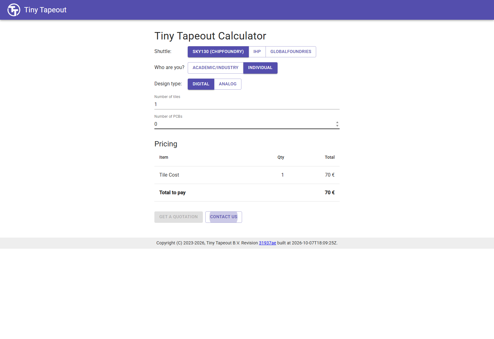

A one-tile, zero-PCB selection displayed €70. A tile coupon or credit does not automatically provide a physical development kit. Individual discounts can be limited, and institutional eligibility, taxes, delivery and current shuttle terms need checking at the time of an approved order. Do not treat this edition's screenshots as a live quotation.

## 4.3 What an approved submission would do

This is an explanation of the later process, not a step to carry out in this exercise. Read the current [official submission guide](https://tinytapeout.com/guides/advanced-workshop/submit-your-design/) before any approved booking.

1. The owner confirms the selected technology/shuttle, the closing date, tile count, budget, rights and delivery expectations. The reviewed files and green runs are prepared first.
2. The owner signs in to the Tiny Tapeout portal with GitHub and creates a project using the repository URL. Any requested account authorisation is reviewed by the owner.
3. The project goes through its order stage. The current public interface uses **Continue to Payment** when an amount is due and **Submit Project** for a zero-total case. A coupon or credit may change the total. A zero amount does not turn an order into a practice simulation.
4. The owner explicitly selects **Submit a new revision** to send a particular source version for integration. Record the commit accepted by that submission. Creating the project or paying alone is not the same as submitting the final design revision.
5. If code changes before the shuttle closes, the new revision needs passing builds and a deliberate new submission. A push to GitHub or a new artifact does not automatically replace the previously submitted version.

The authenticated payment-provider screens were not visited for this manual. No payment screen or confirmation is invented, and the guide makes no claim that the reference counter has been ordered. The practical stopping point remains the evidence package in Section 4.1.

## 4.4 How files become a physical chip

Several different outputs are involved. Your layout describes geometry. Integration combines many user designs with shared infrastructure into a complete chip layout. Manufacturing turns that design into structures on a wafer. Assembly and testing turn separated dies into usable hardware. The tools in this lesson cover preparation and verification of your design; the service and foundry handle the subsequent approved manufacturing process.

### Integration and final preparation

Tiny Tapeout's integration must place the accepted designs into the shared chip and connect them to the selection infrastructure. Additional chip-level checking is necessary because a passing standalone tile is only one part of a complete chip. The accepted source version matters: later edits cannot change geometry already sent for manufacture.

**Tapeout** refers to handing over the final design data for manufacturing. Historically it involved magnetic tape; today the name remains even when files are transferred electronically. It is not the same as clicking a local simulation command.

### Layers, masks and the wafer

A wafer is a disc of semiconductor material containing many repeated chip sites. Manufacturing builds devices and interconnections through many controlled process steps. A useful simplified picture is: deposit or form a material layer, use lithography to define a pattern, remove or modify selected regions, and repeat for later layers. Doping steps alter semiconductor properties; insulating layers separate structures; conductive layers connect the circuit.

Lithography uses patterned exposure to define where a process step acts. Masks and the manufacturing recipe correspond to different layers and operations; the fab does not print a screenshot of your 3D viewer onto silicon. Your coloured layout view is a software representation of geometry across those layers.

Do not read “130 nm” as a promise that every wire or transistor dimension is exactly 130 nm. It identifies the process family. The PDK and rule decks express the applicable dimensions and constraints for each layer and device.

### Why transistors can implement the counter

At a digital abstraction level, a transistor can help control whether a conducting path is available. CMOS logic uses complementary transistor networks to create gates. For example, an inverter produces logical 1 when its input is logical 0 and logical 0 when its input is logical 1, subject to its supply and electrical conditions. Larger networks implement arithmetic and storage cells.

In the counter, the standard-cell library provides the actual flip-flops and combinational gates. You did not draw each transistor; synthesis selected cells, and physical tools placed and connected their layouts. This abstraction makes the student flow manageable while the PDK, library and checks retain the connection to the manufacturing process.

### Wafer testing, dicing, packaging and board testing

After processing, testing can identify dies that work or fail. **Dicing** separates dies from the wafer. **Packaging** provides protected, usable electrical connections; board assembly then connects the packaged device to the development hardware. The exact delivery arrangement depends on the selected service and kit.

The finished chip still needs power, a clock, reset, correct design selection and valid electrical I/O to be used. Simulation does not cover every real-world condition. Manufacturing, assembly, power, external inputs and board handling can introduce issues that are outside the functional test in this guide.

The service publishes shuttle-specific manufacturing and delivery expectations. These are measured in months, not the minutes needed for a software build. Check the current [shuttle schedule](https://tinytapeout.com/chips/) and order information; do not promise a delivery date from an old lecture video.

Sources: [ASML: how microchips are made](https://www.asml.com/en/technology/all-about-microchips/how-microchips-are-made), [ASML: lithography principles](https://www.asml.com/en/technology/lithography-principles), [Tiny Tapeout Making ASICs](https://tinytapeout.com/making_asics/), [Tiny Tapeout FAQ](https://tinytapeout.com/faq/), [current submission guide](https://tinytapeout.com/guides/advanced-workshop/submit-your-design/), [current calculator](https://app.tinytapeout.com/calculator).

## 4.5 How this counter would be used on a board later

This section is conceptual preparation; owning hardware is not required to finish the guide. Follow the guide for the board revision supplied by your class. The [current ETR quickstart](https://tinytapeout.com/guides/get-started-demoboard-etr/) is different from older board instructions.

1. Power and configure the board as its guide specifies. Select the intended design, rather than assuming the pins already reach your tile.
2. Use a suitably slow controlled clock or single-step mode for learning. A 50 MHz timing target does not make the count visually readable at 50 million steps per second.
3. Hold `rst_n` low across a rising edge. The count becomes zero. Release reset before asking it to count.
4. Apply a synchronous count enable on `ui_in[0]`. Other dedicated input bits do not control this counter.
5. Observe `uo_out[7:0]` as a binary number. At count 5, bits 2 and 0 are high, giving `00000101`. A displayed decimal “5” requires a controller or additional decoding; the RTL does not contain a seven-segment decoder.
6. Observe the terminal-count flag on bidirectional bit 0 configured as an output. It is high at 255 while enabled, then low after overflow to zero.

The minimal teaching counter assumes enable is already synchronous to its clock. A physical switch can change near a sampling edge and can bounce. **Synchronisation** reduces the risk of sampling an asynchronous change incorrectly; **debouncing** suppresses repeated apparent changes caused by contact bounce. Those solve different problems. A direct physical button is therefore not equivalent to the ideal, edge-controlled testbench input.

Do not connect arbitrary voltage sources to the I/O pins. Use the board's own instructions and [the current GPIO specifications](https://tinytapeout.com/specs/gpio/) to determine permitted electrical levels and speed. The software simulator's logical 1 does not mean one volt.

## 4.6 Demonstrate understanding before extending the design

Show a demonstrator your own repository, a matching set of passing runs, three waveform observations and one correctly interpreted timing result. Explain the free/paid boundary in your own words.

Then attempt the count-down exercise in Part 1. Write the new behaviour first, adjust the model and flag definition, run the new tests, and inspect the new physical results. The original counter's green evidence does not certify your changed design. A useful extension is one you can explain and test, rather than a larger file you cannot diagnose.

If you cannot yet explain a result, return to the corresponding worked example. That is a normal part of learning chip design. Your evidence note should record the question and the observation that resolved it.


# Appendix A — The complete seven-file example

These files are reproduced verbatim from the verified public commit `61ef06bed008e76000f9ae46d65182e476d15dd6`. The starter ZIP contains the same bytes and correct paths. Preserve the original source credit and licence when adapting the example. Do not copy browser line numbers into the files. The existing official template supplies its remaining infrastructure.

**Use the ZIP when creating files.** Long lines wrap visually to fit this printed page; those display wraps are not extra source-code newlines. Makefile recipe indentation must remain real tab characters where used. The ZIP preserves the original line endings and indentation, so use its files for the browser upload rather than retyping or copying from the PDF. Read the printed code to understand it.

## A.1 — info.yaml

```yaml
# Tiny Tapeout project information
project:
  title:        "8-bit counter (EE6019 worked example)"      # Project title
  author:       "MD. KAMRUL ISLAM"      # Your name
  discord:      ""      # Your discord username, for communication and automatically assigning you a Tapeout role (optional)
  description:  "8-bit synchronous counter with enable, reset and wrap"      # One line description of what your project does
  language:     "Verilog" # other examples include SystemVerilog, Amaranth, VHDL, etc
  clock_hz:     50000000       # Clock frequency in Hz (or 0 if not applicable)

  # How many tiles your design occupies? A single tile is about 167x108 uM.
  tiles: "1x1"          # Valid values: 1x1, 1x2, 2x2, 3x2, 4x2, 6x2 or 8x2

  # Your top module name must start with "tt_um_". Make it unique by including your github username:
  top_module:  "tt_um_mdkamrulislam_counter"

  # List your project's source files here.
  # Source files must be in ./src and you must list each source file separately, one per line.
  # Don't forget to also update `PROJECT_SOURCES` in test/Makefile.
  source_files:
    - "project.v"
    - "counter.v"

# The pinout of your project. Leave unused pins blank. DO NOT delete or add any pins.
# This section is for the datasheet/website. Use descriptive names (e.g., RX, TX, MOSI, SCL, SEG_A, etc.).
pinout:
  # Inputs
  ui[0]: "en: count enable"
  ui[1]: ""
  ui[2]: ""
  ui[3]: ""
  ui[4]: ""
  ui[5]: ""
  ui[6]: ""
  ui[7]: ""

  # Outputs
  uo[0]: "count[0]"
  uo[1]: "count[1]"
  uo[2]: "count[2]"
  uo[3]: "count[3]"
  uo[4]: "count[4]"
  uo[5]: "count[5]"
  uo[6]: "count[6]"
  uo[7]: "count[7]"

  # Bidirectional pins
  uio[0]: "wrap: high while count is 255 and en is high"
  uio[1]: ""
  uio[2]: ""
  uio[3]: ""
  uio[4]: ""
  uio[5]: ""
  uio[6]: ""
  uio[7]: ""

# Do not change!
yaml_version: 6
```

## A.2 — src/counter.v

```verilog
// counter.v - N-bit synchronous up-counter with enable and synchronous reset.
// Example design for the EE6019 open chip flow.
`timescale 1ns / 1ps
`default_nettype none

module counter #(
    parameter WIDTH = 8
) (
    input  wire             clk,
    input  wire             rst,     // synchronous, active high
    input  wire             en,      // count when high
    output reg  [WIDTH-1:0] count,
    output wire             wrap     // high for the cycle count is all ones and en is high
);

    always @(posedge clk) begin
        if (rst)
            count <= {WIDTH{1'b0}};
        else if (en)
            count <= count + 1'b1;
    end

    assign wrap = en & (&count);

endmodule

`default_nettype wire
```

## A.3 — src/project.v

```verilog
/*
 * Copyright (c) 2026 MD. KAMRUL ISLAM
 * SPDX-License-Identifier: Apache-2.0
 */

`default_nettype none

module tt_um_mdkamrulislam_counter (
    input  wire [7:0] ui_in,    // Dedicated inputs
    output wire [7:0] uo_out,   // Dedicated outputs
    input  wire [7:0] uio_in,   // IOs: Input path
    output wire [7:0] uio_out,  // IOs: Output path
    output wire [7:0] uio_oe,   // IOs: Enable path (active high: 0=input, 1=output)
    input  wire       ena,      // always 1 when the design is powered, so you can ignore it
    input  wire       clk,      // clock
    input  wire       rst_n     // reset_n - low to reset
);

  // All output pins must be assigned. If not used, assign to 0.
  counter #(.WIDTH(8)) counter_inst (
      .clk(clk), .rst(~rst_n), .en(ui_in[0]),
      .count(uo_out), .wrap(uio_out[0])
  );
  assign uio_out[7:1] = 7'b0;
  assign uio_oe = 8'b0000_0001;

  // List all unused inputs to prevent warnings
  wire _unused = &{ena, ui_in[7:1], uio_in, 1'b0};

endmodule

`default_nettype wire
```

## A.4 — test/Makefile

```make
# Makefile
# See https://docs.cocotb.org/en/stable/quickstart.html for more info

# defaults
SIM ?= icarus
FST ?= -fst # Use more efficient FST format
TOPLEVEL_LANG ?= verilog
SRC_DIR = $(PWD)/../src
PROJECT_SOURCES = project.v counter.v

ifneq ($(GATES),yes)

# RTL simulation:
SIM_BUILD				= sim_build/rtl
VERILOG_SOURCES += $(addprefix $(SRC_DIR)/,$(PROJECT_SOURCES))

else

# Gate level simulation:
SIM_BUILD				= sim_build/gl
COMPILE_ARGS    += -DGL_TEST
COMPILE_ARGS    += -DFUNCTIONAL
COMPILE_ARGS    += -DUSE_POWER_PINS
COMPILE_ARGS    += -DSIM
COMPILE_ARGS    += -DUNIT_DELAY=\#1
VERILOG_SOURCES += $(PDK_ROOT)/sky130A/libs.ref/sky130_fd_sc_hd/verilog/primitives.v
VERILOG_SOURCES += $(PDK_ROOT)/sky130A/libs.ref/sky130_fd_sc_hd/verilog/sky130_fd_sc_hd.v

# this gets copied in by the GDS action workflow
VERILOG_SOURCES += $(PWD)/gate_level_netlist.v

endif

# Allow sharing configuration between design and testbench via `include`:
COMPILE_ARGS 		+= -I$(SRC_DIR)

# Include the testbench sources:
VERILOG_SOURCES += $(PWD)/tb.v
TOPLEVEL = tb

# List test modules to run, separated by commas and without the .py suffix:
COCOTB_TEST_MODULES = test

# include cocotb's make rules to take care of the simulator setup
include $(shell cocotb-config --makefiles)/Makefile.sim
```

## A.5 — test/tb.v

```verilog
`default_nettype none
`timescale 1ns / 1ps

/* This testbench just instantiates the module and makes some convenient wires
   that can be driven / tested by the cocotb test.py.
*/
module tb ();

  // Dump the signals to a FST file. You can view it with gtkwave or surfer.
  initial begin
    $dumpfile("tb.fst");
    $dumpvars(0, tb);
    #1;
  end

  // Wire up the inputs and outputs:
  reg clk;
  reg rst_n;
  reg ena;
  reg [7:0] ui_in;
  reg [7:0] uio_in;
  wire [7:0] uo_out;
  wire [7:0] uio_out;
  wire [7:0] uio_oe;
`ifdef GL_TEST
  wire VPWR = 1'b1;
  wire VGND = 1'b0;
`endif

  // Replace tt_um_mdkamrulislam_counter with your module name:
  tt_um_mdkamrulislam_counter user_project (

      // Include power ports for the Gate Level test:
`ifdef GL_TEST
      .VPWR(VPWR),
      .VGND(VGND),
`endif

      .ui_in  (ui_in),    // Dedicated inputs
      .uo_out (uo_out),   // Dedicated outputs
      .uio_in (uio_in),   // IOs: Input path
      .uio_out(uio_out),  // IOs: Output path
      .uio_oe (uio_oe),   // IOs: Enable path (active high: 0=input, 1=output)
      .ena    (ena),      // enable - goes high when design is selected
      .clk    (clk),      // clock
      .rst_n  (rst_n)     // not reset
  );

endmodule
```

## A.6 — test/test.py

```python
# SPDX-FileCopyrightText: 2026 MD. KAMRUL ISLAM
# SPDX-License-Identifier: Apache-2.0
"""Use only shared top-level ports, for RTL and gate-level simulation."""
import cocotb
from cocotb.clock import Clock
from cocotb.triggers import FallingEdge, RisingEdge, Timer


@cocotb.test()
async def test_project(dut):
    dut.ena.value = 1
    dut.ui_in.value = 0
    dut.uio_in.value = 0
    dut.rst_n.value = 0
    cocotb.start_soon(Clock(dut.clk, 20, unit="ns").start())
    model = 0

    async def step(enable=0, reset=False):
        nonlocal model
        await FallingEdge(dut.clk)
        dut.ui_in.value = enable
        dut.rst_n.value = int(not reset)
        await RisingEdge(dut.clk)
        model = 0 if reset else ((model + enable) & 0xFF)
        await Timer(8, unit="ns")  # allow the gate-level outputs to settle
        assert int(dut.uo_out.value) == model, f"count: expected {model}"
        expected_wrap = int(bool(enable) and model == 255)
        assert int(dut.uio_out.value) == expected_wrap, "wrap or unused output"
        assert int(dut.uio_oe.value) == 1, "only uio[0] should drive an output"
        return expected_wrap

    for _ in range(3):
        await step(reset=True)
    for _ in range(5):
        await step()
    wraps = 0
    for _ in range(266):
        wraps += await step(enable=1)
    assert wraps == 1, f"expected one wrap indication, saw {wraps}"
    for _ in range(20):
        await step()
    for _ in range(7):
        await step(enable=1)
    await step(enable=1, reset=True)
    await step()
    for _ in range(5):
        await step(enable=1)
    # Disabling en at terminal count suppresses wrap and holds count at 255.
    await step(reset=True)
    for _ in range(255):
        await step(enable=1)
    for _ in range(3):
        await step()
    await step(enable=1)
    assert model == 0
    dut._log.info("PASS: reset, counting, overflow, hold and wrap masking")
```

## A.7 — docs/info.md

```markdown
## How it works

An 8-bit synchronous counter increments on each rising edge of `clk` while
`ui[0]` (`en`) is high. `uo[7:0]` shows its value, from 0 to 255, then back to 0.
When enable is low the count holds. Driving `rst_n` low resets the count to zero
on the next rising edge; reset takes priority over enable.

`uio[0]` (`wrap`) is high while count is 255 and enable is high. During continuous
counting this lasts one clock period every 256 clocks, before the overflow edge.
It is combinational, rather than a registered pulse after overflow.
`uio[7:1]` are inputs and their output data is tied to zero.

This is the EE6019 teaching example, prepared from the official SKY130 Verilog
template. It has not been submitted to any shuttle.

## How to test

1. Select the design and apply a clock (the build target is 50 MHz).
2. Hold `rst_n` low through at least one rising edge, then release it.
3. Set `ui[0]` high: `uo[7:0]` counts upwards and wraps after 255.
4. Observe `uio[0]` high at count 255 while enable is high.
5. Set `ui[0]` low: count holds and wrap goes low.
6. Apply reset again to return the count to zero.

Keep enable stable around the clock edge. A real push button needs
synchronisation and debouncing; this minimal example assumes synchronous enable
from the controller or testbench.

The cocotb test checks reset, more than 256 increments, hold, mid-count reset,
and wrap suppression at terminal count. It uses only top-level ports so the same
checks can run on the gate-level netlist.

## External hardware

None beyond the demo board/controller and a clock source. An optional logic
analyser connected to `uio[0]` makes the wrap indication visible.
```


# Appendix B — Optional local RTL simulation

The main practical route runs simulation and physical implementation on GitHub. You can complete it without this appendix. Local simulation is useful for faster edit/test cycles, and it teaches what the Actions job is doing, but it requires a simulator, Python and make.

## B.1 Choose a supported environment

The commands below use an Ubuntu Linux terminal, including Ubuntu inside an already configured WSL2 environment on Windows. They are not PowerShell commands. A terminal is a text interface where you enter a command and read its output. The current directory is the folder the command operates in.

On Windows, use the main browser route if you do not already have a suitable Linux or managed lab environment. Installing WSL, Docker or a full physical tool suite is not a requirement of this lesson. A native Windows installation has different setup details; do not paste Linux package commands into PowerShell and expect them to work.

On your own Ubuntu installation, these commands install the basic free prerequisites:

```sh
sudo apt-get update
sudo apt-get install -y git python3 python3-venv python3-pip make iverilog
```

`sudo` runs the installation with system privileges. `apt-get` obtains packages from the configured Ubuntu repositories. `python3-venv` allows an isolated Python environment, so the test's package versions do not replace unrelated system Python packages. On a managed lab machine, use the environment supplied by the demonstrator instead of changing system packages.

Check the tools:

```sh
git --version
python3 --version
make --version
iverilog -V
```

Each should identify a tool, rather than report “command not found”. CI for the reference uses Python 3.11, Ubuntu 24.04 and the pinned `test/requirements.txt`. A different local tool version is useful for learning, but is not automatically an identical reproduction of that CI environment.

## B.2 Get your own saved project files

Clone your own completed repository after the seven-file commit. Replace the two capitalised placeholders with your username and repository name:

```sh
git clone https://github.com/YOUR_USERNAME/YOUR_REPOSITORY.git
cd YOUR_REPOSITORY
```

`git clone` copies the saved files and version history. `cd` means change directory. Use the project root: you should see `info.yaml`, `src` and `test`. If you deliberately used a different branch, select it with `git switch BRANCH_NAME` before testing. `git rev-parse HEAD` prints the full commit you checked out.

You can also use a downloaded project ZIP: extract it and open a terminal in the extracted project root. The files matter, but a Git clone makes the version identity and future updates easier to record.

## B.3 Install the pinned Python test packages

Run these from the project root:

```sh
python3 -m venv .venv
source .venv/bin/activate
python -m pip install -r test/requirements.txt
```

The first command creates a virtual environment inside `.venv`. The second selects it for this terminal. The third installs the exact requirements supplied by the template. Installing Python packages alone does not install Icarus Verilog: check both Python and `iverilog` separately.

The reference requirements pin cocotb 2.1.0 and pytest 8.4.2. Follow the requirements in the template you actually copied. Do not silently install the newest cocotb from an old article if your template expects another version.

## B.4 Compile and run, then check the results explicitly

```sh
cd test
make -B
python -m cocotb_tools.check_results results.xml
```

`make` reads the Makefile. `-B` asks it to rebuild rather than assume old compiled outputs are current. Icarus compiles the listed Verilog source and testbench; cocotb drives the simulated top-level signals and checks its assertions. The final command reads the XML test results and signals failure if a test failed. This explicit check matters because make alone can return a successful exit status even when the cocotb result reports failure.

**Check:** the output reports a passing `test_project`, `results.xml` contains one test with zero failures/errors for the unchanged reference, and `tb.fst` exists. The reference's complete test simulates 11,368 ns. Your test's wall-clock runtime will depend on the machine; it is different from simulated circuit time.

**If it does not work:** confirm the current directory is `test`, the virtual environment is active, Icarus is installed, both source files are in `PROJECT_SOURCES`, and the three top-module names agree. Read the first useful compiler or assertion error. A missing file, Python import error and wrong expected count are different problems with different fixes.

Run `cd ..` to return to the project root. Running local simulation does not upload changes or order a chip. To use those edits in GitHub builds, save them through a commit and push using your chosen repository workflow; review the new commit's Actions results.

## B.5 View the FST and understand gate-level dependencies

You can use the free web Surfer steps from Part 2 with the local `test/tb.fst`. A native GTKWave or Surfer installation is optional. Where GTKWave is available, inside `test` use:

```sh
gtkwave tb.fst
```

Add the same top-level signals used in the browser lesson. A saved `tb.gtkw` supplied by the original adder template may refer to old signals; an empty or wrong saved view does not mean the counter waveform is missing.

Local gate-level simulation is a further setup task. It needs the generated netlist from the exact implementation, copied to `test/gate_level_netlist.v`, and a matching installed SKY130 PDK so the cell-model paths in the Makefile exist. Set `PDK_ROOT` to the installed directory **containing** `sky130A`, not to `sky130A` itself. Replace the example path below with that actual directory; these commands check existing files and do not install a PDK. Then run from `test`:

```sh
export PDK_ROOT=/path/to/installed/pdk
test -f "$PDK_ROOT/sky130A/libs.ref/sky130_fd_sc_hd/verilog/primitives.v"
test -f "$PDK_ROOT/sky130A/libs.ref/sky130_fd_sc_hd/verilog/sky130_fd_sc_hd.v"
test -f gate_level_netlist.v
make -B GATES=yes
python -m cocotb_tools.check_results results.xml
```

Each `test -f` check should return a successful exit status. If one fails, locate the missing file and correct the path before invoking make. The matching PDK version is recorded in the build's `pdk.json`; substituting unrelated cell models weakens the comparison with that build.

Without those prerequisites this command will fail to find the netlist or cell models. The main route's `gl_test` job obtains them automatically, which is why this manual uses Actions for the first complete example. Full local hardening is a separate [official setup guide](https://tinytapeout.com/guides/local-hardening/); it is not needed to reach the free checked-layout result here.

Sources: [pinned template test README](https://github.com/TinyTapeout/ttsky-verilog-template/blob/68c3fd3f3ec640e5edcb6a5f74f360ebc016bb2a/test/README.md), [pinned test workflow](https://github.com/TinyTapeout/ttsky-verilog-template/blob/68c3fd3f3ec640e5edcb6a5f74f360ebc016bb2a/.github/workflows/test.yaml), [reference Makefile](https://github.com/mdkamrulislam-web/tt-sky130-counter/blob/61ef06bed008e76000f9ae46d65182e476d15dd6/test/Makefile).


# Appendix C — A glossary to return to

| Term | Plain-English meaning |
|---|---|
| ASIC | A chip made to implement a particular hardware design |
| Bit / bus | One logical signal / a group of signals representing a value |
| RTL | A hardware description of state and logic, before cell mapping |
| HDL / Verilog | Hardware description language / the language used in this example |
| Module / instance | A declared circuit block / a particular use of that block |
| Register / flip-flop | Stored state / a storage element sampled by a clock |
| Clock edge / period | A transition used for sampling / time between successive cycles |
| Synchronous reset | Reset that takes effect on the specified clock edge |
| Active low | A signal is asserted when its logical value is zero |
| Enable / hold | Permission to update / retain the previous stored value |
| Overflow / wrap | Arithmetic exceeds the stored width / the value returns modulo its range |
| DUT | Device under test: the circuit the testbench drives and checks |
| Assertion / model | A checked condition / independently calculated expected behaviour |
| FST / waveform | A stored simulation trace format / signals displayed against time |
| Repository / branch / commit | Project store / named version line / a saved version |
| Workflow / job / artifact | Automated process / one part of it / generated files |
| PDK / standard-cell library | Process information and rules / reusable characterised digital cells |
| Netlist / synthesis | Connected cell instances / transforming RTL into those cells |
| Floorplan / placement | Define the region/interfaces / choose cell positions |
| CTS / skew | Clock-tree synthesis / different clock arrival times |
| Routing / via | Choose wire paths / a connection between layers |
| Extraction / parasitics | Estimate physical electrical effects / resistance and capacitance of geometry |
| STA / SDC | Static timing analysis / its constraint description |
| Setup / hold / slack | Stable-before requirement / stable-after requirement / timing margin |
| DRC / LVS | Check geometric rules / compare physical and intended connectivity |
| Precheck | Tiny Tapeout integration-package checks |
| Tap / filler | Physical body/well connection cell / cell filling physical gaps |
| GDSII / OASIS | Formats representing layout geometry |
| Tile / shuttle | Space assigned to a design / a shared manufacturing run |
| Tapeout / fabrication | Final manufacturing-data handover / making structures on a wafer |
| Wafer / die / package | Semiconductor disc / one chip site or separated chip / usable protection and connections |

## Important identities and source links

Reference counter commit: `61ef06bed008e76000f9ae46d65182e476d15dd6`.

- [Reference files](https://github.com/mdkamrulislam-web/tt-sky130-counter/tree/61ef06bed008e76000f9ae46d65182e476d15dd6)
- [RTL run 37693100752](https://github.com/mdkamrulislam-web/tt-sky130-counter/actions/runs/37693100752)
- [Docs run 37693100755](https://github.com/mdkamrulislam-web/tt-sky130-counter/actions/runs/37693100755)
- [GDS / precheck / GL / viewer run 37693100748](https://github.com/mdkamrulislam-web/tt-sky130-counter/actions/runs/37693100748)
- [Official template snapshot 68c3fd3](https://github.com/TinyTapeout/ttsky-verilog-template/tree/68c3fd3f3ec640e5edcb6a5f74f360ebc016bb2a)
- [HDL templates and rules](https://tinytapeout.com/hdl/templates/)
- [Current Tiny Tapeout FAQ](https://tinytapeout.com/faq/)
- [LibreLane documentation](https://librelane.readthedocs.io/en/stable/)
- [Surfer commands](https://docs.surfer-project.org/book/commands/index.html)

Every screenshot's source page, capture category, date and checksum is recorded in the companion screenshot-sources.json. Source links beside instructions credit official documentation. Published instructional screenshots may show generic or older repositories; the current counter evidence is separately identified. No imitation account interface, simulated failure or manufactured-chip photograph is presented as evidence.
